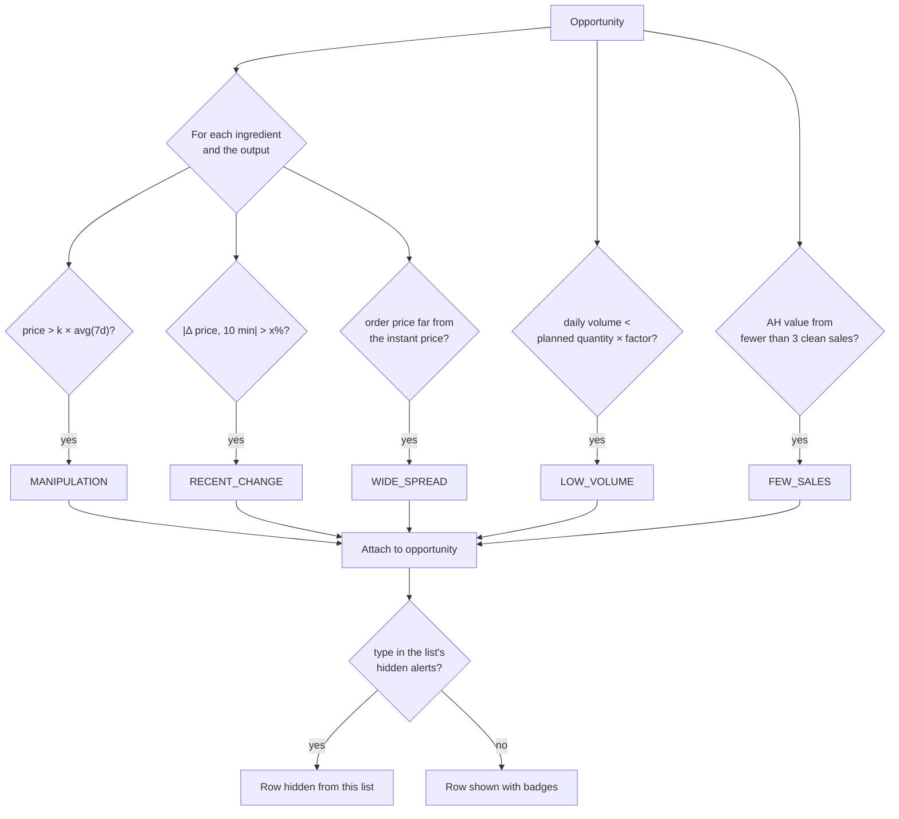

# Alerts

Alerts flag risks on an opportunity before the user spends coins. They appear in the app by default; desktop notifications are optional. Alerts warn; they never remove an opportunity from the list and never act in the game.

**Status:** Implemented. The alerts below are attached to every flipper's opportunities (`RECENT_CHANGE` since M4, `THIN_BOOK` on Bazaar flips since M5, `FEW_SALES` and `WIDE_SPREAD` before M6, `MANIPULATION` in M6). Lists can hide rows by alert type (`hideAlerts`, see [API](api.md#flips)); the thresholds are edited in the Settings tab. Desktop notifications are still planned.

| Alert (implemented) | Trigger |
| --- | --- |
| `MISSING_PRICE` | An input or the output has no price; the opportunity is incomplete and ranks last |
| `ESTIMATED_PRICE` | AH price is the median of recent sales: no listing, or the lowest BIN is above what sells |
| `STALE_PRICE` | Bazaar price older than 30 min, or lowest BIN older than 3 h |
| `FEW_SALES` | The output's Auction House value rests on fewer than `alerts.min-auction-sales` (3) clean sales in 7 days, so a single (often joke) listing can set it |
| `WIDE_SPREAD` | With buy orders and sell offers: a Bazaar order sits more than `alerts.wide-spread` (50%) away from the instant price, and acting instantly instead would take more than half the profit. Not raised on Bazaar Flipper rows, where the spread is the opportunity |
| `MANIPULATION` | A Bazaar purchase or Bazaar-sold output is priced above `alerts.manipulation-ratio` (2×) its 7-day average on the same side of the book. Needs at least a day of history; the message says how many days the average covers. The averages are built in the background: the first time from the whole week (seconds on a full week), then only from the hours since the last refresh (every 10 min); they are rebuilt from scratch every 6 h and after an import |
| `RECENT_CHANGE` | A Bazaar purchase or Bazaar-sold output moved more than 25% (and at least 1 coin) from its price 10 minutes ago (a dump or spike) |
| `THIN_BOOK` | Bazaar Flipper: a side has fewer than `bazaar.thin-book` orders, or the best order stands more than 25% from the next price level |
| `LOW_VOLUME` | Liquidity LOW: daily volume below 3 × the run's output, or a Bazaar ingredient purchase below 3 × its daily volume |
| `BULK_CRAFT` | Buying the inputs of one run takes more items than one inventory holds (36 × 64 = 2,304), counted over every purchase in the plan, crafted parts included. The message gives the items, full inventories and crafts. Forge and Craft Flipper hide these rows unless *Bulk crafts too* is on; Flip Calc leaves them out |
| `UNLOCK_UNKNOWN` | A requirement cannot be checked (HOTM level or collection tier not set, slayer requirements) |
| `FORGE_FINISHED` | A tracked forge slot is done (Forge Tracker) |

The table below is the full design. Thresholds will become configurable; the values are initial defaults.

| Alert | Trigger (initial) | Needs |
| --- | --- | --- |
| Manipulation suspected (`MANIPULATION`, implemented) | Price far above its recent average, for example above 2× the 7-day average | 1 to 7 days of snapshots |
| Low volume | Daily sales too low to sell the planned quantity | Bazaar moving week / AH sales |
| Recent change | Price of an ingredient or output moved sharply in the last 10 minutes | Minute-level snapshots |
| Forge finished | A forge slot is done | Forge Tracker data |

## Evaluation

- Each alert carries a reason the UI can show, for example *"Mithril: price is 1.2k, 2.4× its 7-day average of 500 (3.2 days of history)"*.
- The 7-day averages weigh each hour once (rows are stored only when they change, so a busy hour would otherwise count many times). They are recomputed in the background at most every 10 minutes.
- Alerts are computed when opportunities are computed, and the recent-change and forge-finished alerts are also checked after each collector run.
- Where the output sells is no longer an alert: lists show **Buys** and **Sells** venue columns instead (the former `AH_SOLD_OUTPUT`).
- The UI hides `FEW_SALES` rows by default; each viewer can toggle any filterable alert per flipper, remembered in that browser.

## History requirement

The manipulation and recent-change alerts rely on stored minute-level snapshots, so they are weak until history builds up. The UI marks them as *"limited history"* when less than the required window is stored. Imported databases and Coflnet backfill shorten this warm-up. See [Database](database.md#import-and-export).

## Notifications

- In-app list and badges on opportunities: always on.
- Desktop notifications: optional, through the Tauri notification plugin (**Planned**), mainly for *forge finished*.
