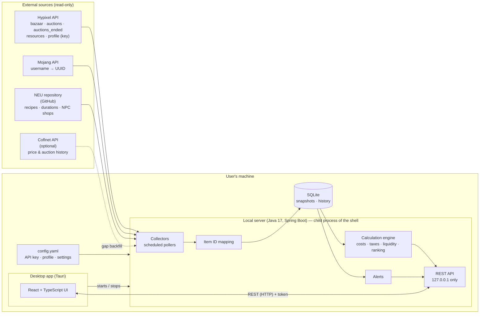
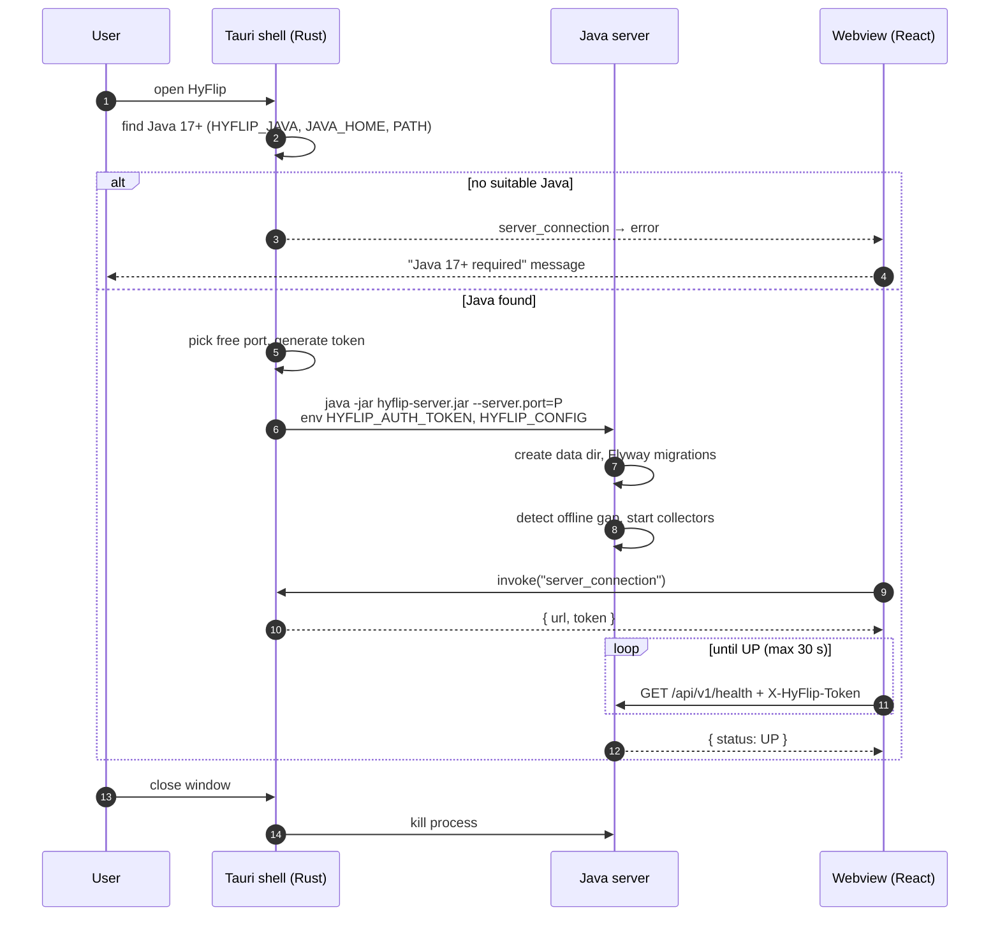
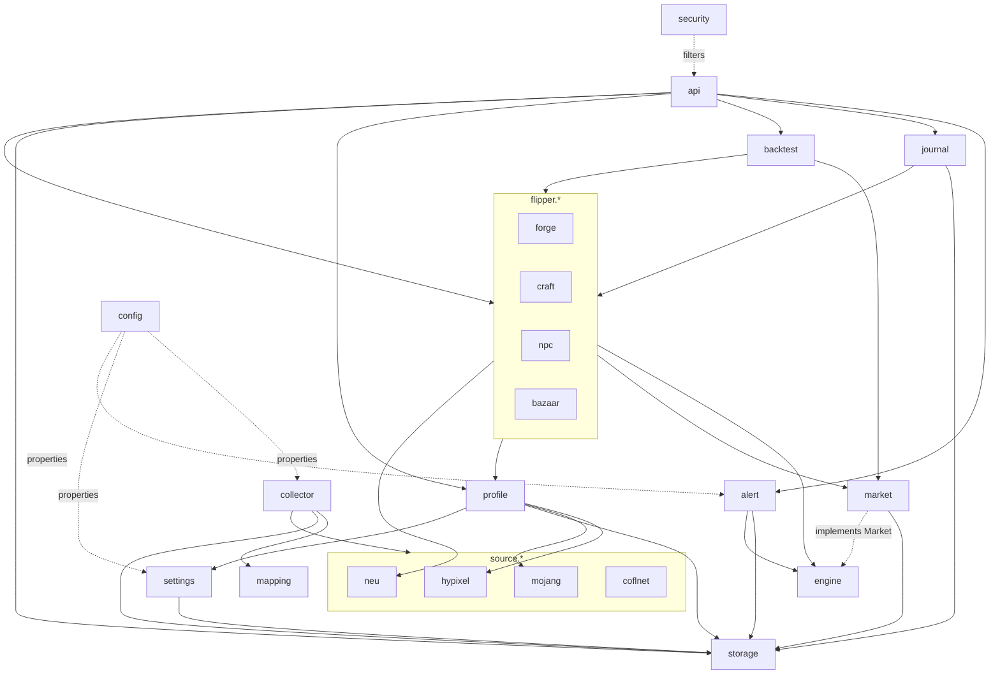
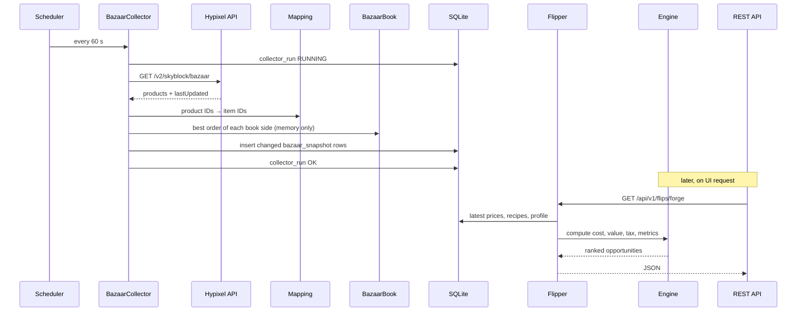
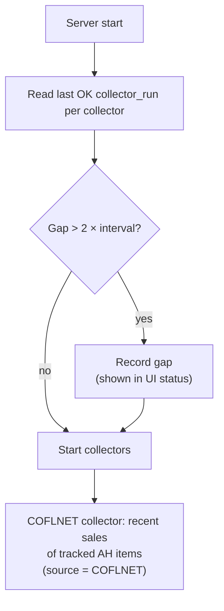

# Architecture

HyFlip is a local-first desktop app. A local Java server is the only component that talks to outside sources; the desktop UI reads everything from it over localhost REST. The app never acts in the game.

## Components

| # | Component | Responsibility |
| --- | --- | --- |
| 1 | Hypixel API | Primary source: Bazaar, auctions, ended auctions, resources, player profile |
| 2 | NEU repository | Forge/craft recipes, base durations, NPC shop data |
| 3 | Coflnet API | Auction House sale history backfill (public API, no account) |
| 4 | Local server | Polling, ID mapping, storage, calculation engine, alerts, REST API |
| 5 | Local database | Snapshots and history (SQLite, default 7 days full resolution) |
| 6 | Config file | All user settings in one YAML file; the real file is git-ignored |
| 7 | Desktop app | Tauri shell with a React + TypeScript UI |

The Mojang API is a small helper source (username to UUID, needed by the profile endpoint) and is not counted as a main component.

## Runtime model

- The Tauri shell launches the Java server as a **child process** when the app opens and stops it on exit. The server runs only while the app is open.
- The server is a plain Spring Boot jar bundled as an app resource and run with the user's Java (17+). See [ADR 0003](decisions/0003-tauri-shell-system-java.md).
- The server binds to `127.0.0.1` only. It never serves data to other machines (Hypixel API policy forbids proxying the Public API).
- Hypixel's API is REST only, so the server polls on a schedule. A push channel (SSE or WebSocket) from server to UI can be added later for live alerts.

### Start-up sequence

In **debug builds** the shell does not spawn the server; developers run it with `./mvnw spring-boot:run` and the shell connects to `http://127.0.0.1:8787`. See [Development](development.md).

## Server modules

The server is organised by feature. Each package has a `package-info.java` describing its responsibility.

| Package | Responsibility | Status |
| --- | --- | --- |
| `api` | REST controllers under `/api/v1`, problem-detail errors | Implemented (flips, Forge Tracker and planner, calibration, items, trade journal, backtest, profile linking, settings, import/export, status) |
| `security` | Per-launch token filter | Implemented |
| `config` | Typed `config.yaml` (`HyFlipProperties`), CORS, data directory, outbound HTTP client | Implemented |
| `source.hypixel` | Hypixel API v2 client (keyless endpoints and profiles with the personal key), NBT `item_bytes` decoder | Implemented |
| `source.mojang` | Username to UUID | Implemented |
| `source.neu` | NEU repository download, extraction and recipe parser | Implemented |
| `source.coflnet` | Sold-auction history client for the `COFLNET` backfill collector | **Implemented** |
| `collector` | Scheduled pollers, run bookkeeping, backoff, offline-gap detection | Implemented |
| `mapping` | Item ID rules, registry, catalogue sync and re-mapping | Implemented |
| `storage` | `JdbcClient` repositories, retention and downsampling, history import/export (`DatabaseTransfer`) | Implemented |
| `settings` | Settings edited in the app over `config.yaml`, API key entered in the app | Implemented |
| `engine` | Pure calculations: pricing, fees, cost sheets, buy-or-craft planning, metrics, liquidity, forge speed, calibration fit | Implemented |
| `market` | Database-backed price views for the engine (latest or as of a moment), 7-day averages kept per hour, item price history | Implemented |
| `journal` | Trade journal: recorded flips, actual results, accuracy per flipper and alert | Implemented |
| `backtest` | Replays a flipper over stored history and values its picks at later prices | Implemented |
| `flipper.*` | Forge, Craft, NPC, Bazaar flippers; shared `RecipeBook`, `FlipContext`, `FlipSupport`; Forge Tracker and calibration in `flipper.forge` | All four implemented |
| `alert` | Alert types attached to opportunities and slots | Implemented (including `MANIPULATION` from 7-day averages) |
| `profile` | Personal context from settings and the linked profile, profile linking, unlock checks, election perks, key expiry | Implemented |

**Dependency rule:** `engine` holds pure functions over prices and profile values and does not call sources or the database directly; it is unit-tested without Spring. Flippers gather inputs, call the engine and return results.

## Data flow

1. **Polling.** Collectors poll on configurable intervals (Bazaar and `auctions_ended` every 60 s, tracked auctions every 30 min, resources and NEU daily). See [Data sources](data-sources.md).
2. **Mapping.** Item IDs from Hypixel, NEU and Bazaar are normalised through the mapping layer before storage.
3. **Storage.** Every poll is stored as a snapshot; history is built locally because Hypixel only returns the present moment.
4. **Calculation.** Flippers read snapshots and the user profile, then rank opportunities through the shared engine.
5. **Presentation.** The UI fetches opportunities, recipes, alerts and forge status over REST.

## Offline gaps

Data is collected only while the app is open. On start, the server detects the gap since the last successful `collector_run`:

- Gaps are recorded in `collection_gap` and listed by `GET /api/v1/status` (**implemented**).
- The `COFLNET` collector refills Auction House sale history of tracked items from Coflnet's public sold-auction endpoint, which covers about a week, so missed `auctions_ended` windows are mostly recovered (**implemented**, see [Data sources](data-sources.md#coflnet)). Bazaar history missed while offline stays empty; the live book needs only the latest poll.
- A dedicated always-on collection server may replace this later (see [Roadmap](roadmap.md)).

## Security

| Threat | Mitigation |
| --- | --- |
| Other machines reading the API | Server binds to `127.0.0.1` only |
| A web page in the user's browser calling `localhost` (CSRF, reading the config and API key) | Every `/api/**` request must carry `X-HyFlip-Token`, a random token generated per launch by the shell and passed to the server through the environment. CORS allows only the Tauri webview and the Vite dev origin |
| API key leaking through git | Real `config.yaml` is git-ignored; repo ships `config.example.yaml` |
| Token visible in process list | Passed via environment variable, not a command-line argument |

In development the token is empty by default, which disables the check. Never ship a build without the token.

## Hypixel API key

- For now each user supplies their own **personal** API key from the Hypixel Developer Dashboard. Personal keys expire every 3 days and must be renewed.
- The key is entered in the Settings tab (stored in `app_state`, never returned by the API or exported) or in `config.yaml`. The app stores when it was entered and warns before it expires; it also reports when Hypixel rejects the key (HTTP 403).
- Only profile features need the key. Bazaar, auctions and resources work without it.
- Later the project may move to an application key and a project-owned server. See [ADR 0005](decisions/0005-personal-api-keys.md).

## Technology

| Layer | Choice | ADR |
| --- | --- | --- |
| Server | Java 17, Spring Boot 4, Maven | [0002](decisions/0002-java-spring-boot-server.md) |
| Database | SQLite via Spring JDBC (`JdbcClient`), Flyway migrations | [0004](decisions/0004-sqlite-jdbc-flyway.md) |
| Desktop shell | Tauri 2 (Rust), server as child process | [0003](decisions/0003-tauri-shell-system-java.md) |
| UI | React 19 + TypeScript, Vite | [0003](decisions/0003-tauri-shell-system-java.md) |
| App ↔ server | REST over localhost, per-launch token | [0001](decisions/0001-local-first-read-only.md) |
