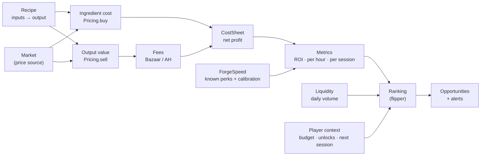
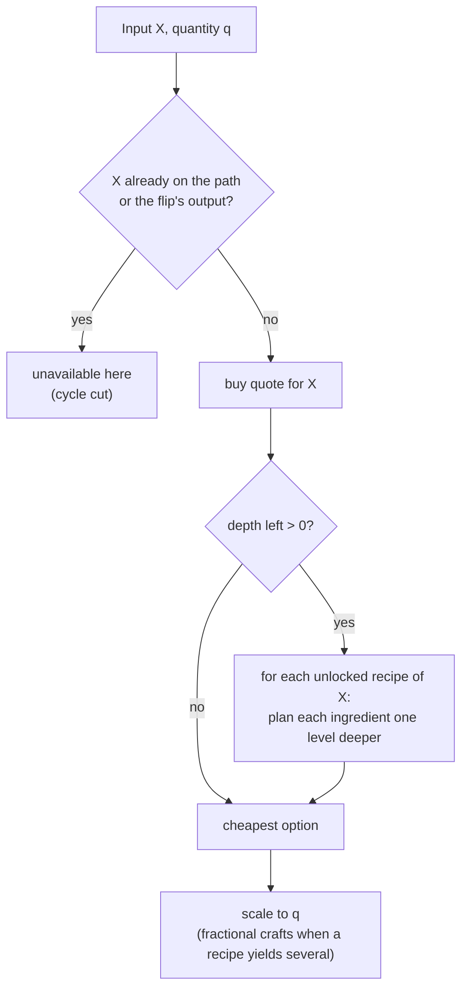
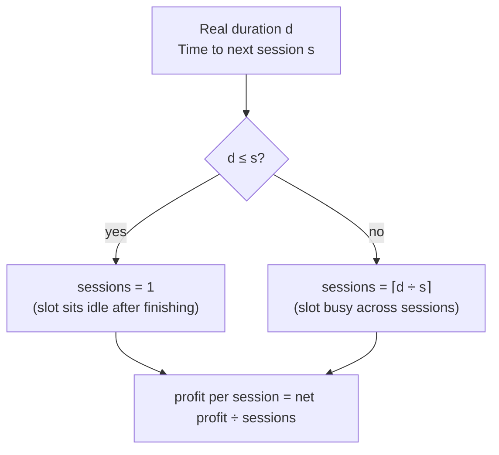

# Calculation Engine

Every flipper uses the same engine for costs, taxes, liquidity and ranking, so numbers mean the same thing on every screen. The engine lives in `com.hyflip.server.engine` and holds pure functions over prices and profile values: no database, no HTTP, no Spring. That keeps it fully unit-testable.

**Status:** Implemented in M2 and used by the Forge Flipper. Metric definitions are recorded in [ADR 0007](decisions/0007-profit-per-session.md). Fee rates are **to verify** in game.

## Pipeline

| Class | Role |
| --- | --- |
| `Market` | Interface the engine reads prices from: Bazaar quote, Auction House quote, NPC sell price. `market.MarketService` implements it over the database (latest, or as of a past moment); `StaticMarket` serves tests |
| `Pricing` | Buy and sell quotes for an item, choosing the venue |
| `Fees` | Bazaar tax, AH listing fee tiers and claim tax |
| `CostSheet` | Prices a whole recipe: lines, coins, cost, output, fees, net profit, missing prices |
| `Metrics` | Net profit, ROI, profit per hour, sessions, profit per session |
| `Liquidity` | HIGH / MEDIUM / LOW from daily volume versus quantity |
| `ForgeSpeed`, `Calibration` | Real forge duration; see [Forge](forge.md) |

## Inputs

| Input | Source |
| --- | --- |
| Recipe (inputs, quantities, coins, output, base duration) | NEU repository |
| Bazaar prices | Now: the best single orders of the latest poll (in memory, `BazaarBook`), with volumes and order counts from the latest `bazaar_snapshot`. Past moments and alert comparisons: the stored `bazaar_snapshot` (`quick_status` averages) |
| AH prices | Latest lowest **clean** BIN (`auction_lowest_bin`) and the median per-unit price of **clean** `auction_sale` rows over 7 days (Hypixel and Coflnet) |
| NPC sell prices | `item.npc_sell_price` from the Hypixel items resource |
| Personal context | Config today ([Configuration](configuration.md)); profile API later |

## Price source and venues

| Setting | Buying ingredients | Selling output |
| --- | --- | --- |
| `INSTANT` | Insta-buy price (lowest sell offer) | Insta-sell price (highest buy order) |
| `ORDER` (default) | Place a buy order 0.1 above the highest buy order | Place a sell offer 0.1 under the lowest sell offer |

Mapping to stored Bazaar fields (semantics verified 2026-11-17, see [Data sources](data-sources.md#get-v2skyblockbazaar)):

| Need | `INSTANT` | `ORDER` |
| --- | --- | --- |
| Cost to buy | `buy_price` | `sell_price` |
| Value when selling | `sell_price` | `buy_price` |

A price of `0` means that side of the book is empty; the other side is used instead. If both are 0 the Bazaar has no price.

**Live book.** `quick_status` prices are averages over the top of the book and can sit far from the best single order: Superb Carrot Candy showed 117k against a best buy order of 290k, so a buy order at the average never fills. Every flipper therefore prices "now" from the best orders of the latest poll when it is under 30 minutes old, and an `ORDER` price is one step (0.1) ahead of the best order so it is first in line. Without a live book (the first minute after start) the averages are used as they are, without the step. Recent-change alerts compare stored snapshots on both ends, so a live price is never mistaken for a sudden move.

**Fill realism.** A buy order only fills when someone insta-sells. When the instant price is more than `alerts.wide-spread` (50%) away from the order price, the cost or value assumes a fill that may take days, and a `WIDE_SPREAD` alert says how many fill a day and what acting instantly would cost.

**Venue choice.** Buying takes the cheapest of the Bazaar and the AH lowest BIN. Selling takes the venue with the highest value after fees among Bazaar, AH and NPC.

### Auction House values

A crafted or forged item comes out **clean**: no stars, recombobulator, hot potato books, enchantments, gemstones, scrolls, runes, dyes or skins. Upgraded copies sell for far more (a 5-star, fully enchanted Heroic Yeti Sword sold for 44M while clean ones sell for 13.5–18M), so only clean listings and sales are used. Reforges are allowed: most add little and nearly every listing has one. Pets and enchanted books are exempt, their value-defining attributes are already in the canonical ID. The rule lives in `ItemCondition`; sales stored before it existed count as not clean.

**The value is conservative:** the lower of the lowest clean BIN and the median per-unit price of clean sales. When the median is used the quote is marked *estimated*. If fewer than `alerts.min-auction-sales` (3) clean sales were seen in 7 days, the value can rest on one joke listing (a 100M Rabbit Helmet that never sold), so the row gets `FEW_SALES`, which the UI hides by default. Coflnet backfill fills the history of a fresh install (see [Data sources](data-sources.md#coflnet)).

## Taxes and fees (to verify)

| Fee | Rule | Config |
| --- | --- | --- |
| Bazaar sell tax | Fraction of the sale value on insta-sells and filled sell offers. Base 1.25%, lower with the Bazaar Flipper community shop upgrade | `trading.bazaar-tax-rate` |
| AH listing fee (BIN) | 1% below 10M, 2% from 10M, 2.5% from 100M of the listing price | `trading.auction-fees.*` |
| AH claim tax | 1% of a sale above 1M | `trading.auction-fees.claim-tax-*` |
| AH duration fee | Small, not modelled | — |
| NPC | No tax. The 640 per item per day NPC buy limit matters for the NPC Flipper (M4) | — |

Each AH unit is treated as its own listing, since forge outputs sold on the AH rarely stack.

## Metrics

| Metric | Definition |
| --- | --- |
| Cost | recipe coins + Σ quantity × buy price of each input |
| Value | output quantity × sell price |
| Net profit | value − fees − cost |
| ROI | net profit ÷ cost (none when the cost is 0) |
| Real duration | from the forge speed model (see [Forge](forge.md)) |
| Profit per hour | net profit ÷ real duration in hours; none for instant flips (crafting) |
| Sessions | ⌈real duration ÷ time to next session⌉, at least 1 |
| Profit per session | net profit ÷ sessions (default ranking for the forge) |
| Runs per day | NPC Flipper: daily shop limit and a share of market volume (see [Flippers](flippers.md#npc-flipper)). Bazaar Flipper: units, a share of the slower side's filled volume (see [Flippers](flippers.md#bazaar-flipper)) |
| Profit per day | net profit × runs per day (default ranking for NPC and Bazaar flips) |
| Liquidity | daily volume ÷ output quantity: HIGH ≥ 20, MEDIUM ≥ 3, else LOW. Bazaar daily volume = (`buy_moving_week` + `sell_moving_week`) ÷ 7; AH = units sold per day over the stored sale history (up to 7 days) |

Cost uses the cheapest way to obtain each input, buying or crafting it (next section). Crafted inputs are priced at the cost of their own ingredients.

### Intermediates: buy or craft

**Status:** implemented (`engine.CraftPlanner`, `engine.Plan`), used by every recipe flipper and the Forge Tracker.

For each input the planner compares the buy price with every allowed crafting recipe for it, recursively, and keeps the cheapest. The result is a `Plan` tree (`BUY`, `CRAFT` or `MISSING`) attached to each cost-sheet line.

- **Depth:** 3 crafting levels below a recipe input (`CraftPlanner.DEFAULT_DEPTH`).
- **Cycles:** an item is never used inside its own production chain (iron ingot ↔ iron block), and the flip's output never appears in its inputs' plans.
- **Locked recipes** (collection tier or HOTM below the requirement) are never used for intermediates.
- **Memoisation:** unit plans are cached per request by item and remaining depth. A plan computed under a cycle cut depends on the path and is not cached; a cached plan is reused only if it does not touch the current path.
- Only crafting recipes are considered for intermediates; forging an input would add hours and is left to the Forge Flipper.
- Market impact is not modelled: buying thousands of a leaf ingredient moves its price. Bazaar purchases whose daily volume is under 3× the quantity get a `LOW_VOLUME` alert.

### Why profit per session

Profit per hour inflates very short recipes that the player cannot realistically repeat. Profit per session asks: *if I fill the slot now, how much does it earn for each session it is busy?*

With `s` = 8 h, a 30-second recipe and a 6-hour recipe both count one session; a 7-day recipe at 20% Quick Forge (134 h) counts 17 sessions.

## Ranking

1. Hide recipes that fail hard filters: locked (HOTM or collection tier below the requirement), over budget, below the minimum daily volume. Requirements the context cannot check (no HOTM level set, slayer requirements) are **not** hidden; they get an `UNLOCK_UNKNOWN` alert.
2. Sort by the chosen metric. Opportunities with a missing price always rank last.
3. Attach alerts (they warn, they never remove). See [Alerts](alerts.md).

## Testing

- Golden test with live Refined Mithril prices of 2026-11-17 (`CostSheetTest`).
- Property test over random prices: net profit never exceeds value, ROI sign equals profit sign, profit per session never exceeds net profit.
- Unit tests for venue choice, empty book sides, fee tiers, liquidity, calibration fits and forge speed.
