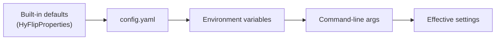
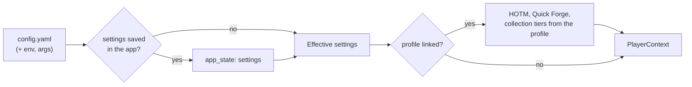

# Configuration

All user settings live in one YAML file, `config.yaml`, under the root key `hyflip`. The repo ships [`config.example.yaml`](../config.example.yaml); the real file is git-ignored and keys are never committed.

Linking a Hypixel profile through the API is optional and fills the personal values automatically.

## Where the file lives

| Context | Location |
| --- | --- |
| Installed app, Linux | `~/.config/com.hyflip.app/config.yaml` |
| Installed app, Windows | `%APPDATA%\com.hyflip.app\config.yaml` |
| Development | `src/server/config.yaml` (the server's working directory) |
| Override | environment variable `HYFLIP_CONFIG=<path>` |

The shell sets `HYFLIP_CONFIG` when it starts the server. The server imports the file through `spring.config.import`, so any field can also be overridden by an environment variable (`HYFLIP_TRADING_BUDGET=...`) or a command-line argument (`--hyflip.trading.budget=...`).

Later sources override earlier ones.

## Fields

**Status:** all fields below are bound by `HyFlipProperties` (implemented). `player`, `trading`, `forge`, `npc`, `bazaar` and `alerts` can also be edited in the app (**Settings** tab); once saved there, the app's copy is used instead of these sections, without a restart. Other sections need a restart.

### `hypixel`

| Field | Type | Default | Purpose |
| --- | --- | --- | --- |
| `api-key` | string | `""` | Personal key from the Hypixel Developer Dashboard. Only profile features need it |
| `api-key-issued-at` | ISO-8601 instant | none | When the key was created; drives the expiry warning |
| `api-key-lifetime` | duration | `3d` | Lifetime of a personal key |
| `base-url` | URL | `https://api.hypixel.net` | Hypixel API base URL |
| `mojang-url` | URL | `https://api.mojang.com` | Mojang API base URL (username to UUID for profile linking) |
| `profile-interval` | duration | `10m` | How often the linked profile is read again |

The key can also be entered in the app (Settings → Profile). A key entered there wins over this one and is stored in the database (`app_state`), never in exports.

### `player`

| Field | Type | Default | Purpose |
| --- | --- | --- | --- |
| `username` | string | `""` | Minecraft username, resolved to a UUID |
| `profile` | string | `""` | SkyBlock profile name (for example `Apple`); empty selects the active profile |
| `coop-member` | string | `""` | Co-op member whose personal data is read; empty means the player |
| `hotm-level` | integer | none | Manual HOTM level when the profile API is not linked. Unset: HOTM requirements are not checked (`UNLOCK_UNKNOWN`) |
| `forge-slots` | integer | none (2 is assumed) | Manual forge slot count when the profile API is not linked |
| `collections` | map of collection to tier | `{}` | Manual collection tiers that gate recipes. Keys are collection IDs (`MITHRIL_ORE`) or names (`Mithril`) |

Personal data (HOTM, forge slots, purse) comes from the chosen member; shared data (bank) from the profile.

### `trading`

| Field | Type | Default | Purpose |
| --- | --- | --- | --- |
| `budget` | coins | none (no limit) | Hide flips the user cannot afford |
| `bazaar-tax-rate` | fraction | `0.0125` | Bazaar sell tax; lower with the Bazaar Flipper community shop upgrade (**to verify** current values in game) |
| `price-source` | `ORDER` \| `INSTANT` | `ORDER` | Buy order / sell offer prices, or insta-buy / insta-sell prices |
| `auction-fees.small-rate` | fraction | `0.01` | AH BIN listing fee below `medium-from` (**to verify**) |
| `auction-fees.medium-rate` | fraction | `0.02` | Listing fee from `medium-from` |
| `auction-fees.large-rate` | fraction | `0.025` | Listing fee from `large-from` |
| `auction-fees.medium-from` | coins | `10000000` | Start of the medium tier |
| `auction-fees.large-from` | coins | `100000000` | Start of the large tier |
| `auction-fees.claim-tax-rate` | fraction | `0.01` | Tax when claiming a sale above `claim-tax-from` |
| `auction-fees.claim-tax-from` | coins | `1000000` | Claim tax threshold |

### `forge`

| Field | Type | Default | Purpose |
| --- | --- | --- | --- |
| `quick-forge-reduction` | fraction | none (0) | Quick Forge perk as the HOTM tree shows it, for example `0.2` for 20% |
| `molten-forge` | `AUTO` \| `ON` \| `OFF` | `AUTO` | Cole's Molten Forge perk (25%); `AUTO` reads the election resource |
| `next-session-in` | duration | `8h` | Usual time until you can refill a forge slot; drives profit per session |

### `npc`

| Field | Type | Default | Purpose |
| --- | --- | --- | --- |
| `daily-limit` | integer | `640` | Items of one kind a player can buy from NPC shops per day (to verify) |
| `market-share` | fraction | `0.05` | Share of an item's daily traded volume you expect to buy or sell without moving the price; caps runs per day |

### `bazaar`

| Field | Type | Default | Purpose |
| --- | --- | --- | --- |
| `market-share` | fraction | `0.05` | Share of the slower side's daily filled volume your orders can expect to fill; gives units per day |
| `thin-book` | integer | `5` | Fewer orders than this on either side of the book raise a `THIN_BOOK` alert |

### `alerts`

| Field | Type | Default | Purpose |
| --- | --- | --- | --- |
| `min-auction-sales` | integer | `3` | An Auction House value from fewer clean sales than this in 7 days raises `FEW_SALES` |
| `wide-spread` | fraction | `0.5` | A Bazaar order whose instant price is this much worse raises `WIDE_SPREAD` |
| `manipulation-ratio` | number | `2` | A Bazaar price above this multiple of its 7-day average raises `MANIPULATION` |

### `display`

| Field | Type | Default | Purpose |
| --- | --- | --- | --- |
| `time-zone` | string | empty | IANA time zone for clock times such as when a forge job ends (`Europe/Istanbul`); empty uses the computer's zone. Unknown names are rejected |

### `collection`

| Field | Type | Default | Purpose |
| --- | --- | --- | --- |
| `enabled` | boolean | `true` | Master switch for all collectors (off in tests) |
| `bazaar-interval` | duration | `60s` | Bazaar poll interval. Hypixel caches for 60 s, so faster gains nothing |
| `auctions-ended-interval` | duration | `60s` | Ended auctions poll interval; must stay ≤ 60 s or sales are lost |
| `auctions-interval` | duration | `30m` | Full active-auction scan for tracked items' lowest BIN. About 55 MB per scan, see [bandwidth](data-sources.md#bandwidth) |
| `resources-interval` | duration | `24h` | Items, collections, election refresh |
| `retention-interval` | duration | `1h` | How often the retention job runs |
| `tracked-auction-items` | list of NEU IDs | `[]` | Extra items whose lowest BIN is recorded, on top of recipe items not sold on the Bazaar |

### `neu`

| Field | Type | Default | Purpose |
| --- | --- | --- | --- |
| `enabled` | boolean | `true` | Download recipes from the NEU repository |
| `refresh-interval` | duration | `24h` | How often to check GitHub for a new commit |
| `commit-url` | URL | GitHub API, `NotEnoughUpdates/NotEnoughUpdates-REPO` `master` | Latest-commit lookup |
| `archive-url` | URL template | `https://github.com/NotEnoughUpdates/NotEnoughUpdates-REPO/archive/{sha}.zip` | Archive to download; `{sha}` is replaced |

### `retention`

| Field | Type | Default | Purpose |
| --- | --- | --- | --- |
| `full-resolution` | duration | `7d` | How long minute-level history is kept |
| `downsample` | boolean | `true` | Keep hourly summaries of older data instead of deleting it |

### `coflnet`

| Field | Type | Default | Purpose |
| --- | --- | --- | --- |
| `enabled` | boolean | `true` | Fetch Auction House sale history from Coflnet's public API (no account; only item IDs are sent) |
| `interval` | duration | `5m` | How often a backfill run starts |
| `items-per-run` | integer | `40` | Items fetched per run, never-fetched first |
| `request-interval` | duration | `3s` | Pause between requests (Coflnet allows about 100 a minute) |
| `refetch-after` | duration | `24h` | An item's history is fetched again after this long |
| `base-url` | URL | `https://sky.coflnet.com` | Coflnet API |
| `token` | string | `""` | Reserved for Coflnet account features; not needed for backfill |

### Runtime values (set by the shell, not by users)

| Field | Purpose |
| --- | --- |
| `data-dir` | Directory for the database and caches (default `./data`) |
| `auth-token` | Per-launch token required in `X-HyFlip-Token`; empty disables the check (dev only) |
| `server.port` | Port the server listens on (default `8787`) |

Duration values use Spring's format: `60s`, `5m`, `24h`, `7d`.

## Planned settings

These will be added with the features that use them:

- Further alert thresholds (low-volume minimum, recent-change window). See [Alerts](alerts.md).
- Desktop notifications on/off.

## Editing in the app

**Implemented.** The Settings tab edits `player`, `trading` (including the Auction House fee tiers), `forge`, `npc`, `bazaar` and `alerts` through `GET` / `PATCH /api/v1/settings`. The server validates the values and stores them in the database (`app_state` key `settings`); `config.yaml` is never rewritten, so its comments stay. Until something is saved in the app, the config file applies; *Back to config.yaml* drops the app's copy.

Theme (system, light, dark) and accent colour are per window and kept in the browser storage of the app window, not on the server.

## Profile API settings

Profile data depends on the player's in-game API settings (SkyBlock Menu → Settings → API Settings). When fields are missing from the profile response, the app lists which settings to enable instead of showing zeros.
