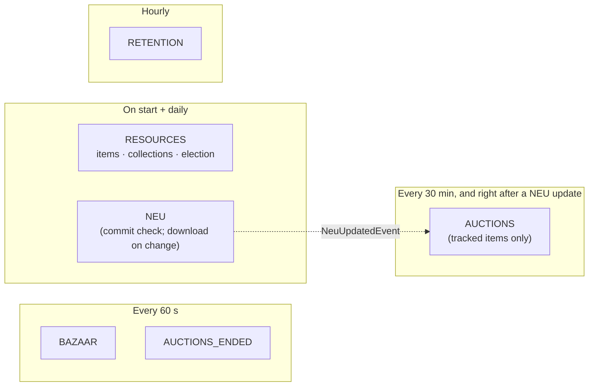
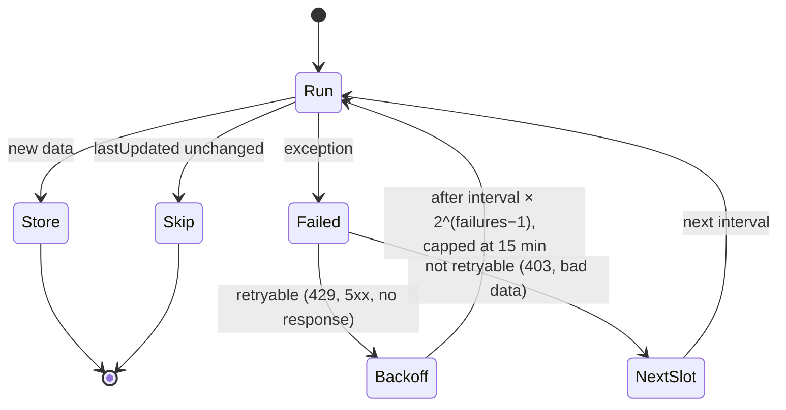
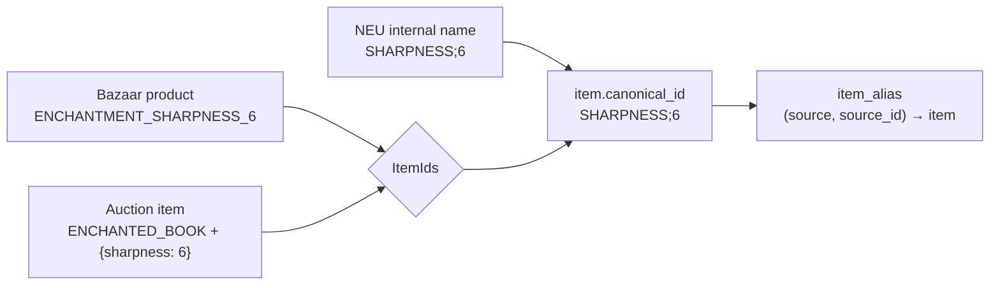

# Data Sources

The Hypixel API only returns the present moment, so HyFlip builds its own history by storing snapshots. Without stored snapshots there are no trends, no manipulation checks and no expected-vs-realised profit.

All sources are **read-only**. The server is the only component that calls them, through one shared HTTP client (`config.HttpConfig`) with gzip, 10 s connect / 60 s read timeouts and the User-Agent `HyFlip/<version>` (it never identifies the user).

## Overview

| Source | What it provides | Key needed | Collector | Default interval | Status |
| --- | --- | --- | --- | --- | --- |
| Hypixel `/v2/skyblock/bazaar` | Quick status per product | No | `BAZAAR` | 60 s | **Implemented** |
| Hypixel `/v2/skyblock/auctions_ended` | Real sale prices, last ~60 s | No | `AUCTIONS_ENDED` | 60 s | **Implemented** |
| Hypixel `/v2/skyblock/auctions` | Active auctions; lowest BIN of tracked items | No | `AUCTIONS` | 30 min | **Implemented** |
| Hypixel resources (items, collections, election) | Names, NPC sell prices, collection tiers, mayor/minister | No | `RESOURCES` | 24 h | **Implemented** |
| NEU repository (GitHub) | Forge/craft recipes, durations, NPC shops, Bazaar stock names | No | `NEU` | 24 h (download only on new commit) | **Implemented** |
| Hypixel SkyBlock profiles | HOTM, collections, purse, forge data (to verify) | Yes (personal key) | — | On demand | Planned (M6) |
| Mojang API | Username to UUID | No | — | On demand | Planned (M6) |
| Coflnet `/api/auctions/tag/{tag}/sold` | Recent sales of AH items (cold start and offline gaps) | No | `COFLNET` | 5 min, 40 items per run, each item at most daily | **Implemented** |

Every run is recorded in `collector_run` and shown by `GET /api/v1/status`.

## Bandwidth

Measured on 2026-11-17 with gzip:

| Request | Size | Per day at default interval |
| --- | --- | --- |
| Bazaar | ~0.46 MB | ~670 MB |
| Ended auctions | ~0.19 MB | ~280 MB |
| One active-auctions page (of ~41) | ~1.3 MB | — |
| Full active-auctions scan | ~55 MB | ~2.6 GB at 30 min |
| NEU archive | ~22 MB | only when the repository changes |

Auction item data (`item_bytes`) is already gzipped and base64-encoded, so pages barely compress. That is why the active-auction scan defaults to 30 minutes and is skipped entirely when no items are tracked. Users on metered connections should raise `collection.auctions-interval`.

## Hypixel API

Base URL: `https://api.hypixel.net` (configurable as `hyflip.hypixel.base-url`). Keyless responses are served from Hypixel's CDN cache (`cache-control: max-age=60`), so polling faster than once a minute only returns the same data. Collectors compare `lastUpdated` and skip unchanged responses.

### `GET /v2/skyblock/bazaar`

- Returns `lastUpdated` (epoch ms) and `products`, a map from product ID to `quick_status`, `buy_summary` and `sell_summary`. About 2,200 products.
- `quick_status` fields stored: `buyPrice`, `sellPrice`, `buyVolume`, `sellVolume`, `buyMovingWeek`, `sellMovingWeek`, `buyOrders`, `sellOrders`. See [Database](database.md#bazaar_snapshot).
- **Price semantics (verified 2026-11-17):** `sellPrice` follows `sell_summary`, which lists **buy orders**, so it is roughly what an insta-sell gets. `buyPrice` follows `buy_summary`, which lists **sell offers**, so it is roughly what an insta-buy costs. Both are weighted averages of the top of the book, not the single best order. Example: Enchanted Diamond `sellPrice` 1,258.8 vs best buy order 1,259.7; `buyPrice` 1,346.7 vs best sell offer 1,335.3.
- A side with no orders has price `0` (about 450 products at the time of checking). The engine must treat 0 as "no market", not as free.
- Order books (`buy_summary`, `sell_summary`) are not stored. The best price level of each side (price, amount, next level's price) is kept in memory from every poll for the Bazaar Flipper (`market.BazaarBook`).
- `quick_status` `buyOrders` counts **sell offers** (`buy_summary` entries) and `sellOrders` counts **buy orders**, like the prices (verified 2026-11-18 on products with short books).
- **Only changed products are stored:** a row is written when any `quick_status` field differs from the product's previous stored row.

### `GET /v2/skyblock/auctions_ended`

- About 200 auctions that ended in roughly the last 60 seconds: `auction_id`, `price` (total), `bin`, `timestamp`, `item_bytes`, plus buyer and seller IDs.
- Must be polled at least once a minute; anything older is gone. Buyer and seller IDs are **not** mapped or stored.

### `GET /v2/skyblock/auctions?page=N`

- About 40,000 active auctions in ~41 pages of 1,000. The collector reads every page, keeps only BIN auctions of tracked items and stores the lowest price **per unit** (`starting_bid / count`) and the number of listings.
- **Tracked items** = forge and crafting inputs/outputs from NEU that are not sold on the Bazaar, plus `collection.tracked-auction-items`.

### Item data (`item_bytes`)

Base64 of gzipped NBT. `source.hypixel.Nbt` is a small NBT reader; `AuctionItem` extracts:

| Field | NBT path |
| --- | --- |
| SkyBlock ID | `i[0].tag.ExtraAttributes.id` |
| Stack size | `i[0].Count` |
| Variant data | `i[0].tag.ExtraAttributes` (`enchantments`, `petInfo`, `runes`, ...) |

### Resources

| Endpoint | Used for | Stored in |
| --- | --- | --- |
| `/v2/resources/skyblock/items` | Item names, NPC sell prices (`npc_sell_price`, ~2,450 items have one); `item_model`, `material`, `durability` and `glowing` for [item icons](#item-icons) | `item`; icon fields only when icons are built |
| `/v2/resources/skyblock/collections` | Collection tiers that gate recipes | `resource_snapshot` (raw JSON) |
| `/v2/resources/skyblock/election` | Current mayor and minister (for example Cole's perks) | `resource_snapshot` (raw JSON) |

### Profiles (personal key)

**Implemented** (`PROFILE` collector and `POST /api/v1/profile/link`).

- The username is first resolved to a UUID: `GET https://api.mojang.com/users/profiles/minecraft/<name>`. Only the name is sent.
- `GET /v2/skyblock/profiles?uuid=<uuid>` with header `API-Key: <key>` returns every profile of the player, each with all co-op `members`. The profile is chosen by `cute_name` (`player.profile`), else the one with `selected: true`; personal data is read from the member (`player.coop-member`, else the player).
- Fields read (checked on a real response, 2026-11-18):

| Path under the member | Use |
| --- | --- |
| `skill_tree.experience.mining` (older: `mining_core.experience`) | HOTM experience → level: 0, 3k, 12k, 37k, 97k, 197k, 347k, 557k, 847k, 1.247M for levels 1–10 |
| `skill_tree.nodes.mining.quick_forge` (older: `mining_core.nodes.forge_time`) and `toggle_quick_forge` | Quick Forge level: 10% + 0.5% per level, 30% at level 20 (**to verify** in game; level 11 gave 15.5%, matching a 16% calibration) |
| `player_data.unlocked_coll_tiers` | Entries like `MITHRIL_ORE_9`: highest unlocked tier per collection |
| `forge.forge_processes.forge_1.<n>` | `{ id, startTime, slot }` per busy slot: the Forge Tracker is filled from it |

- The profile does not say how many forge slots are unlocked, only which are busy; `player.forge-slots` stays the source for the slot count.
- The player's in-game **API settings** control what is visible; a missing section leaves the manual value in place.
- **To verify:** how delayed profile data is compared with the game.

### Rate limits and keys

- Keyless responses carry no rate-limit headers (checked 2026-11-17); they are CDN-cached.
- Keyed requests count against the key's limit, a fixed number of requests per 5-minute window shown on the Developer Dashboard. Profile linking makes one request per `hypixel.profile-interval` (10 min), far below it; a `429` is reported as `RATE_LIMITED` and retried with backoff.
- Personal keys expire every 3 days. `GET /api/v1/status` reports the key state from its issue date (now, for a key entered in the app); a `403` is reported as `KEY_REJECTED` in the Settings tab.

### Error handling

`CollectorScheduler` records every run (`RUNNING` → `OK` / `FAILED` with the error text), never runs one collector twice at the same time, and marks runs left `RUNNING` by a crash as failed on the next start.

## NEU repository

- Source: [`NotEnoughUpdates/NotEnoughUpdates-REPO`](https://github.com/NotEnoughUpdates/NotEnoughUpdates-REPO), **MIT licensed** (checked 2026-11-17), so derived data can be redistributed with the copyright notice.
- On start the copy in `<data-dir>/neu/repo` is loaded synchronously, before other collectors run. The `NEU` collector then asks the GitHub API for the latest commit (`commits/master`) and downloads the archive for that SHA only if it changed. Only `items/` and `constants/` are extracted (zip-slip and size checked) into a staging folder, parsed, then swapped in.
- About 8,970 items. Parsed recipes (2026-11-17): 2,565 crafting, 124 forge, 1,095 NPC shop.

| NEU data | Used as |
| --- | --- |
| `items/<ID>.json` `internalname`, `displayname` | Canonical ID and display name (formatting codes stripped) |
| `crafttext` ("Requires: HotM 2", "Requires: Gemstone X & HotM 5") | Unlock requirements (HOTM or other, with level); `&` joins several |
| `recipe` (legacy grid) and `recipes[type=crafting]` | Crafting recipe; duplicate grid ingredients summed; `count` is the output amount |
| `recipes[type=forge]` | Forge recipe with `duration` in seconds |
| `recipes[type=npc_shop]` | NPC shop offer; `SKYBLOCK_COIN:n` becomes a coin cost (forge recipes too, for example 25,000 coins for a Gemstone Chamber) |
| `constants/bazaarstocks.json` | Bazaar product to NEU ID for shards (`SHARD_CRETAN_BULL` → `ATTRIBUTE_SHARD_MYTHOLOGICAL_RESISTANCE;1`) |

Ingredient strings are `ID:amount`; some amounts are decimals (`DARK_CANDY:10.0`). `drops`, `trade` and `katgrade` recipes are not parsed yet (Kat flips are post-MVP).

## Item ID mapping

Canonical IDs are **NEU internal names**, because NEU names every variant uniformly and its recipes use them. `mapping.ItemIds` holds the rules:

| Source | Rule | Example |
| --- | --- | --- |
| Bazaar shard | `bazaarstocks.json` lookup | `SHARD_CRETAN_BULL` → `ATTRIBUTE_SHARD_MYTHOLOGICAL_RESISTANCE;1` |
| Bazaar enchantment | `ENCHANTMENT_<NAME>_<LEVEL>` → `<NAME>;<LEVEL>` | `ENCHANTMENT_SHARPNESS_6` → `SHARPNESS;6` |
| Vanilla damage value | `:` → `-` | `INK_SACK:3` → `INK_SACK-3` |
| Auction: enchanted book with one enchantment | `<ENCHANT>;<LEVEL>` | `{sharpness: 6}` → `SHARPNESS;6` |
| Auction: pet | `<TYPE>;<tier index>` (COMMON 0 … MYTHIC 5) | Legendary Golden Dragon → `GOLDEN_DRAGON;4` |
| Auction: rune | `<RUNE>_RUNE;<LEVEL>` | `{MUSIC: 1}` → `MUSIC_RUNE;1` |
| Everything else | unchanged | `REFINED_MITHRIL` |

- **Coverage (2026-11-17):** 97% of Bazaar products map to an existing NEU item. The rest (about 69, mostly retired enchantments such as `ENCHANTMENT_CAYENNE_1`) are still stored and listed in `unmapped_id` for review. Items from the Hypixel items resource are not counted: it is a catalogue of its own and lists about 420 items NEU lacks (removed, admin or event items).
- `ItemRegistry` resolves `(source, source_id)` to an `item` row, creating it on first sight, and caches the result.
- **Late NEU:** on the very first start the Bazaar may be polled before NEU is downloaded, so shards get fallback IDs. When NEU loads, `ItemCatalogSync` re-points those aliases and moves their history to the correct item.
- Multi-enchantment books stay `ENCHANTED_BOOK`; potions, attribute-rolled gear and other variants keep their base ID for now.

## Coflnet

- **What:** recent sold auctions per item (`GET https://sky.coflnet.com/api/auctions/tag/{tag}/sold`, about a week, no key). Hypixel's `auctions_ended` only covers the last minute, so without this a fresh install has too few sales to price crafted outputs.
- **How:** the `COFLNET` collector fetches tracked plain item IDs (pets, books and runes are named differently on Coflnet and skipped), never-fetched first, one request every 3 s, and refetches an item after 24 h. Rows go to `auction_sale` with `source = 'COFLNET'`; Hypixel and Coflnet rows share auction IDs, so nothing is counted twice. Each sale's condition is read from Coflnet's `enchantments` and `flattenedNbt` (see [Calculation engine](calculation-engine.md#auction-house-values)).
- **Privacy:** requests carry an item ID and the app's User-Agent, nothing about the user. Seller and buyer IDs in the response are not stored. `coflnet.enabled: false` turns it off.
- **Terms (checked 2026-11-18, [API wiki](https://sky-commands.coflnet.com/wiki/api)):** public endpoints need no key; limits are 30 requests per 10 s and 100 per minute per IP, sequential requests preferred (we send one per 3 s and stop a run on `429`). **Attribution is required** on every page that uses the data, linking to `https://sky.coflnet.com/data` ("Prices provided by SkyCofl"); the UI shows it under every flipper list. **Commercial products must fund Coflnet's servers through a Premium+ subscription**, which matters if HyFlip is ever sold or monetised.
- Hypixel stays the primary source; the app works without Coflnet, only with a slower warm-up.

## Item icons

Icons are optional and built on the player's computer from files they already have. Nothing is shipped with HyFlip or sent anywhere.

- **Hypixel SkyBlock resource pack.** The game downloads it from Hypixel into `.minecraft/downloads/<server>/<sha1>` (a zip without extension; Prism and other launchers keep the same folder per instance). Settings → Item icons searches those folders, `resourcepacks` and Downloads, or takes a path or an uploaded file. A pack counts if it has `assets/hypixel_skyblock/items/`. The pack license (`LICENSE` inside the pack, v1.0, 2026-07-07) lets Hypixel-related apps use its assets as long as they are not sold or charged for, and asks not to suggest Hypixel endorses the app; HyFlip only reads the player's own copy.
- **Mapping.** The items API's `item_model` (about 1,360 items, for example `BAT_WAND` → `hypixel_skyblock:item/island_relevant/dungeons/spirit_sceptre`) gives the exact model; pack files it does not list are matched by file name to known item IDs.
- **Vanilla items.** Items Hypixel draws as plain Minecraft items have no `item_model`; their 1.8 `material` and `durability` (`INK_SACK` 4) are translated to today's ID (`lapis_lazuli`) and drawn from the player's newest Minecraft 1.21.4+ client jar (`versions/<v>/<v>.jar`, or Prism's `libraries/com/mojang/minecraft`), read in place and never copied. Enchanted books come from NEU's `itemid`. Full blocks are drawn as an isometric cube like the inventory shows them.
- **Not drawn:** player heads (talismans, essences, attribute shards, pets) have no texture of their own; they keep a letter in their rarity colour.
- **Result.** One atlas of 32 px cells (`<data-dir>/icons/atlas.png`, about 400 KB) and `index.json`. Textures are scaled by whole steps only and animated ones use their first frame. A copy of the pack (`pack.zip`, about 18 MB) is kept so the atlas can be rebuilt. Every 6 hours, once icons are loaded, the server looks for a newer pack (Hypixel updates it as a new file) and rebuilds. On the developer's data: 4,384 items in about 4 s; 67–84% of the rows in each flip list get an icon.

## Sources

- [SkyBlock API – Hypixel SkyBlock Wiki](https://hypixelskyblock.minecraft.wiki/w/SkyBlock_API)
- [API Policy – Hypixel Developer](https://developer.hypixel.net/policies)
- [NotEnoughUpdates-REPO – GitHub](https://github.com/NotEnoughUpdates/NotEnoughUpdates-REPO)
- [Programmatic API access – SkyCofl](https://sky-commands.coflnet.com/wiki/api)
- [Safe tracker tools – SkyCofl](https://sky.coflnet.com/guides/safe-tracker-tools)
- Hypixel SkyBlock Resource Pack License v1.0 (the `LICENSE` file inside the pack)
