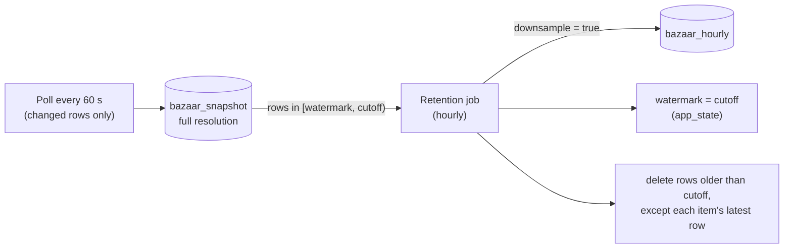
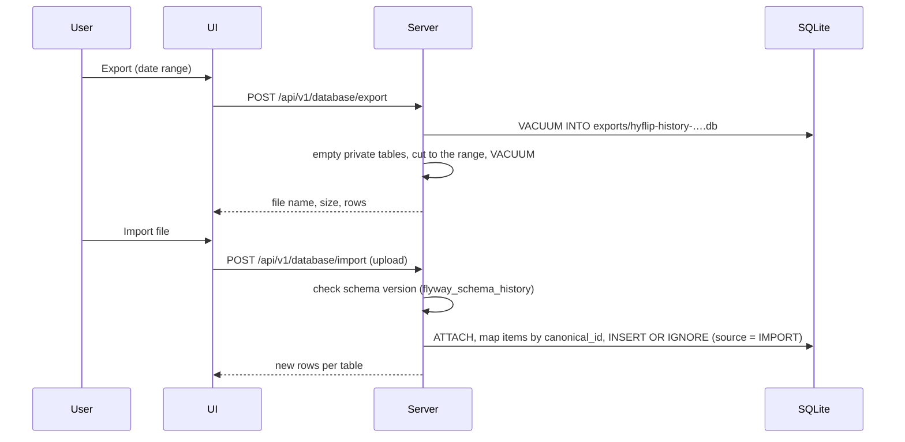

# Database

HyFlip stores everything in one local SQLite file, `<data-dir>/hyflip.db`. The schema is owned by Flyway migrations in `src/server/src/main/resources/db/migration`; the server accesses it through Spring `JdbcClient` (no ORM). See [ADR 0004](decisions/0004-sqlite-jdbc-flyway.md).

The app was called SkyPAYNA before 0.1.0. On start the server renames an old `skypayna.db` (with its `-wal` and `-shm` files) to `hyflip.db` and moves `config.yaml` settings from `skypayna:` to `hyflip:`, and the desktop app moves its `com.skypayna.app` folders to `com.hyflip.app`. Nothing is overwritten when the new name already exists. The first migration file still says SkyPAYNA in a comment: migrations are never edited, because Flyway checks their checksums.

## Conventions

- Timestamps are Unix epoch **milliseconds**, UTC, stored as `INTEGER`.
- Prices are coins, stored as `REAL`.
- Item references use the integer `item.id`, never source strings, to keep snapshot rows small. `item.canonical_id` is the NEU internal name (see [Item ID mapping](data-sources.md#item-id-mapping)).
- `source` columns record where a row came from: `HYPIXEL`, `COFLNET` (backfill) or `IMPORT`.
- Connection settings: WAL journal, foreign keys on, 5 s busy timeout (set in the JDBC URL).
- Migrations are append-only: never edit an applied `V<n>__*.sql`; add a new one.

## Schema

**Status:** implemented in `V1__init.sql` (core tables), `V2__collection.sql` (resources, gaps, unmapped IDs, auction summaries, bookkeeping) and `V3__forge.sql` (Forge Tracker and calibration columns).

```mermaid
erDiagram
    item ||--o{ item_alias : "known as"
    item ||--o{ bazaar_snapshot : "priced in"
    item ||--o{ bazaar_hourly : "summarised in"
    item ||--o{ auction_sale : "sold as"
    item ||--o{ auction_lowest_bin : "listed as"
    item ||--o{ auction_hourly : "summarised in"

    item {
        INTEGER id PK
        TEXT canonical_id UK
        TEXT display_name
        REAL npc_sell_price
        INTEGER updated_at
    }
    item_alias {
        TEXT source PK
        TEXT source_id PK
        INTEGER item_id FK
    }
    bazaar_snapshot {
        INTEGER item_id PK
        INTEGER taken_at PK
        REAL buy_price
        REAL sell_price
        INTEGER buy_volume
        INTEGER sell_volume
        INTEGER buy_moving_week
        INTEGER sell_moving_week
        INTEGER buy_orders
        INTEGER sell_orders
        TEXT source
    }
    bazaar_hourly {
        INTEGER item_id PK
        INTEGER hour_start PK
        REAL buy_price_avg
        REAL buy_price_min
        REAL buy_price_max
        REAL sell_price_avg
        REAL sell_price_min
        REAL sell_price_max
        INTEGER samples
    }
    auction_sale {
        TEXT auction_id PK
        INTEGER ended_at
        INTEGER item_id FK
        REAL price
        INTEGER bin
        INTEGER item_count
        TEXT source
        INTEGER clean
    }
    auction_lowest_bin {
        INTEGER item_id PK
        INTEGER taken_at PK
        REAL price
        INTEGER listings
    }
    collector_run {
        INTEGER id PK
        TEXT collector
        INTEGER started_at
        INTEGER finished_at
        TEXT status
        INTEGER rows_written
        TEXT error
    }
    forge_job {
        INTEGER id PK
        INTEGER slot
        TEXT recipe_id
        INTEGER started_at
        INTEGER expected_end_at
        REAL expected_cost
        REAL expected_value
        REAL realised_value
        INTEGER realised_at
        INTEGER collected_at
        INTEGER base_seconds
        TEXT source
    }
    trade {
        INTEGER id PK
        TEXT flip_type
        TEXT opportunity_id
        TEXT name
        REAL runs
        INTEGER started_at
        REAL expected_cost
        REAL expected_value
        TEXT alerts
        REAL actual_cost
        REAL actual_revenue
        INTEGER finished_at
        TEXT note
    }
    auction_hourly {
        INTEGER item_id PK
        INTEGER hour_start PK
        INTEGER sales
        INTEGER units
        REAL unit_price_avg
        REAL unit_price_min
        REAL unit_price_max
    }
    resource_snapshot {
        TEXT name PK
        INTEGER fetched_at
        TEXT body
    }
    unmapped_id {
        TEXT source PK
        TEXT source_id PK
        INTEGER first_seen
        INTEGER last_seen
        INTEGER seen
    }
    collection_gap {
        INTEGER id PK
        TEXT collector
        INTEGER gap_start
        INTEGER gap_end
        INTEGER detected_at
        INTEGER backfilled
    }
    app_state {
        TEXT key PK
        TEXT value
    }
    forge_calibration {
        INTEGER id PK
        TEXT recipe_id
        INTEGER base_seconds
        REAL known_reduction
        INTEGER observed_seconds
        INTEGER recorded_at
    }
```

| Table | Purpose |
| --- | --- |
| `item` | Canonical items after ID mapping |
| `item_alias` | Source-specific IDs mapped to canonical items |
| `bazaar_snapshot` | Bazaar `quick_status` per product per poll (full resolution) |
| `bazaar_hourly` | Hourly summaries kept after full-resolution data expires |
| `auction_sale` | Ended auctions (real sale prices) from Hypixel and Coflnet (`source`); `clean` is 1 for items without value-adding upgrades, 0 with upgrades, NULL for rows stored before V4 (treated as not clean) |
| `auction_lowest_bin` | Lowest BIN of clean copies of tracked items over time; `listings` counts clean listings |
| `coflnet_backfill` | When each item's sale history was last fetched from Coflnet, and how many sales came back |
| `auction_hourly` | Hourly ended-auction summaries (per-unit prices) kept after sales expire |
| `collector_run` | One row per collector run: health, errors, offline-gap detection |
| `resource_snapshot` | Latest raw JSON of the election and collections resources |
| `unmapped_id` | Bazaar and auction IDs whose canonical form is not a NEU item, for review |
| `collection_gap` | Periods without history because the app was closed |
| `app_state` | Internal key-value bookkeeping (retention watermarks) |
| `forge_job` | Forge jobs for the Forge Tracker: expected cost and net value at start, realised value from prices at the end, collection time, and `sold_value` (what the player says they received). At most one uncollected job per slot (partial unique index) |
| `trade` | Trade journal (V5): flips the player recorded, with the expected cost and net value for all runs at recording time, the alert types then (JSON), and what the player entered as paid and received |
| `forge_calibration` | Samples from the forge speed calibration wizard, with the known perk reduction in effect when measured |

Recipes from NEU are kept as files under `<data-dir>/neu/repo` and parsed into memory on start (**implemented**); they are not stored in SQLite.

**Changed rows only.** `BAZAAR` writes a product only when a `quick_status` field changed since its previous stored row. A product's latest row is therefore its current state, even when old. History queries must carry the last value forward between rows.

## Retention and downsampling

**Status:** implemented (`storage.RetentionService`, run hourly by the `RETENTION` collector).

Default: 7 days at full resolution (`retention.full-resolution`), then downsampled to hourly summaries (`retention.downsample: true`) instead of deleted.

- `cutoff` is `now − full-resolution`, rounded down to the hour, so only complete hours are summarised.
- Rows between the previous watermark and the cutoff are summarised once, then the watermark moves. The kept latest row of a rarely-changing item is therefore never summarised twice.
- Each item's latest Bazaar snapshot and lowest BIN row are kept regardless of age, so the current price never disappears.
- Ended auctions are summarised into `auction_hourly` (per-unit average, min, max) and deleted.
- Old `collector_run` rows are deleted, keeping each collector's latest run and latest successful run (gap detection needs it).
- Hourly averages are over stored changes, not time-weighted; an hour with no change has no summary row for that item.
- Rows that arrive later with timestamps behind the watermark (future backfill or import) are not summarised automatically.

## Storage estimate

Measured on 2026-11-17 over the first minutes of collection:

| Measure | Value |
| --- | --- |
| Bazaar products | 2,207 |
| Products changed per 60 s poll | ~820 (37%) |
| Rows per day | ~1.2 million |
| Bytes per row incl. time index | ~80 |
| **Bazaar, 7 days** | **~660 MB** |
| Ended auctions per minute | ~190 |
| Tracked items with a lowest BIN | ~910 per scan |

The change rate varies with player activity, so these numbers need checking over a full day (see [Roadmap](roadmap.md#open-questions-and-tests)). If the database grows too large, the next steps are tracking a subset at full resolution and a shorter default retention. The UI shows the current size in the status panel.

## Query performance

Measured on 2026-11-18 on the real data (2 h, 62 k Bazaar rows, 29 k sales) and on a synthetic copy stretched to a week (5.2 M Bazaar rows, 2.4 M sales, 825 MB):

| Operation | Real data | One week |
| --- | --- | --- |
| Craft Flipper list (warm) | 0.35 s → 0.07–0.10 s | 0.13–0.15 s |
| NPC / Bazaar / Forge list (warm) | 0.23 / 0.21 / 0.04 s → 0.07 / 0.07 / 0.05 s | 0.09 / 0.11 / 0.07 s |
| Latest Bazaar row of every item | 7 ms | 14 ms |
| 7-day Bazaar averages | — | 13 s once, then about 40 ms per new hour |
| Price history of one item (7 days, ~400 points) | under 10 ms | under 1 ms in SQLite |

- **One statement per table, not per item.** A market view loads the latest Bazaar row and lowest BIN of every item in one statement each, on first use. A flip list touches over a thousand items, and preparing a statement per item was most of its time.
- **CROSS JOIN from `item`.** It keeps SQLite seeking per item through the primary key, so the cost does not grow with history. A plain join can scan every snapshot row.
- **Live sales reused for 60 s.** Live views keep each item's 7-day clean sales that long: they change only when the ended-auctions collector runs.
- **Backtests** value each pick from its list row, not its detail view, and reuse one market view per sale time.

## Import and export

**Implemented** (Settings → Market history; `POST /api/v1/database/export` and `/import`). Users can export and import market history, and the maintainer can publish ready-made databases so new users do not start empty (the cold-start problem; publishing comes with the first release).

- Export never includes the config file, the API key or personal data: `app_state` (settings, key, linked profile), `forge_job`, `forge_calibration`, `trade`, `collector_run`, `collection_gap`, `unmapped_id` and `coflnet_backfill` are emptied in the copy.
- Import merges `item`, `bazaar_snapshot`, `bazaar_hourly`, `auction_sale`, `auction_lowest_bin` and `auction_hourly` (`INSERT OR IGNORE` on primary keys). Item IDs differ between databases, so rows are matched by `canonical_id`. Columns missing in an older file stay at their defaults (an `auction_sale` without `clean` counts as not clean).
- Files with a newer schema version than the app are refused. One transfer runs at a time.
- Imported Bazaar rows sit between the local changed-only rows; history queries carry the last value forward as before.
