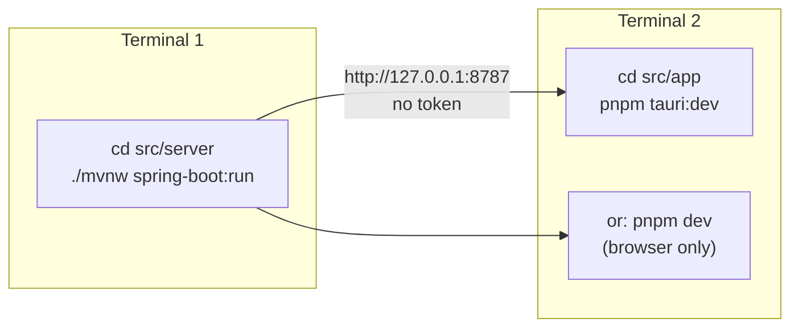

# Development

## Prerequisites

| Tool | Version | Used for |
| --- | --- | --- |
| JDK | 17+ | Server (`src/server`) |
| Maven | via `./mvnw` (wrapper included) | Server build |
| Node.js | 24+ | UI (`src/app`) |
| pnpm | 12 (pinned in `package.json`) | UI dependencies |
| Rust | stable | Tauri shell (`src/app/src-tauri`) |
| Tauri system deps | see [Tauri prerequisites](https://v2.tauri.app/start/prerequisites/) | WebKitGTK on Linux, WebView2 on Windows |

### Windows

Install the tools with `winget` (a regular PowerShell is enough unless noted):

```powershell
winget install EclipseAdoptium.Temurin.17.JDK
winget install OpenJS.NodeJS
winget install Rustlang.Rustup
winget install Microsoft.VisualStudio.2022.BuildTools --override "--wait --passive --add Microsoft.VisualStudio.Workload.VCTools --includeRecommended"
```

| Problem | Fix |
| --- | --- |
| Rust fails with `link.exe not found` or a missing Windows SDK | Visual Studio Build Tools 2022 with "Desktop development with C++" (the last command above, or what `rustup-init` offers) |
| `corepack enable` fails with `EPERM ... C:\Program Files\nodejs\yarnpkg` | Run it once in an administrator PowerShell |
| `pnpm.ps1 cannot be loaded because running scripts is disabled` | `Set-ExecutionPolicy -Scope CurrentUser RemoteSigned`, or call `pnpm.cmd` |
| A tool is "not recognized" right after installing it | Close and reopen the terminal so it picks up the new `PATH` |

Copy the project to an NTFS drive before building: exFAT has no symlinks, which `node_modules` and `target` use. Leave both folders out of the copy; `pnpm install` and the build recreate them.

## Repository layout

```text
HyFlip/
├── .github/workflows/ci.yml      CI: server, UI, shell (Linux + Windows)
├── assets/                       Logos and other project media
├── config.example.yaml           Template for the user config (copy to config.yaml)
├── docs/                         This documentation
│   └── decisions/                Architecture decision records
├── src/
│   ├── server/                   Java 17 · Spring Boot · Maven
│   │   ├── pom.xml
│   │   ├── mvnw, mvnw.cmd, .mvn/
│   │   └── src/
│   │       ├── main/java/com/hyflip/server/
│   │       │   ├── HyFlipServerApplication.java
│   │       │   ├── api/          REST controllers (/api/v1)
│   │       │   ├── security/     Per-launch token filter
│   │       │   ├── config/       HyFlipProperties, CORS, data dir
│   │       │   ├── source/       hypixel · mojang · neu · coflnet clients
│   │       │   ├── collector/    Scheduled pollers, gap detection
│   │       │   ├── mapping/      Item ID mapping
│   │       │   ├── storage/      JdbcClient repositories, retention
│   │       │   ├── engine/       Shared calculations (pure)
│   │       │   ├── flipper/      forge · craft · npc · bazaar
│   │       │   ├── alert/        Risk alerts
│   │       │   └── profile/      Personal context, calibration
│   │       ├── main/resources/
│   │       │   ├── application.yaml
│   │       │   └── db/migration/ Flyway SQL migrations
│   │       └── test/java/…       JUnit 5 + Spring Boot tests
│   └── app/                      React 19 · TypeScript · Vite
│       ├── package.json
│       ├── src/
│       │   ├── main.tsx, App.tsx
│       │   └── api/              Server connection and typed client (+ tests)
│       └── src-tauri/            Tauri 2 shell (Rust)
│           ├── tauri.conf.json
│           ├── tauri.release.conf.json   Adds the server jar to the bundle
│           └── src/
│               ├── lib.rs        App setup, server_connection command
│               ├── server.rs     Start/stop the Java server
│               └── java.rs       Find Java 17+
├── LICENSE                       GPL-3.0
└── README.md
```

Tests live next to the code they test: `src/server/src/test/java`, `*.test.ts` beside UI sources, `#[cfg(test)]` modules in Rust.

### Server test setup

- `src/test/resources/config/application.yaml` turns collectors and NEU downloads off, so tests never call the network.
- `support.DatabaseTest` starts the Spring context with a real SQLite file in a temp directory. Spring caches the context, so subclasses share one database: use your own item IDs or clean the tables you assert on.
- `support.FakeHypixelApi` replaces the Hypixel client with fixture responses; tests swap responses or set `failure`.
- `support.NbtWriter` builds `item_bytes` for tests (books, pets, stacks).
- `src/test/resources/fixtures/` holds trimmed live data from 2026-11-17: Hypixel responses (player IDs zeroed) and a few NEU item files with NEU's MIT license.
- Engine and flipper logic are tested without Spring through `engine.StaticMarket`. HTTP tests that need NEU data copy the fixtures into the data directory and call `NeuRepository.loadLocal()` (see `api.ForgeApiTest`); give such a test its own `@TestPropertySource` so its context and database are separate.

## Running in development

Run the server and the UI separately; the debug shell does not spawn the server.



```sh
# 1. Server (creates ./data/hyflip.db, reads ./config.yaml if present).
#    Collectors start at once: the first run downloads the NEU repository (~22 MB).
#    Set hyflip.collection.enabled=false in config.yaml to work offline.
cd src/server
cp ../../config.example.yaml config.yaml   # optional, then edit
./mvnw spring-boot:run

# 2a. Desktop app with hot reload
cd src/app
pnpm install
pnpm tauri:dev

# 2b. Or only the UI in a browser at http://localhost:1420
pnpm dev
```

Override the dev connection with `HYFLIP_SERVER_URL` / `HYFLIP_SERVER_TOKEN` (Tauri shell) or `VITE_SERVER_URL` / `VITE_SERVER_TOKEN` (browser). To test the token check locally, start the server with `--hyflip.auth-token=dev` and set the matching variable.

## Testing

```sh
cd src/server && ./mvnw verify        # JUnit + Spring Boot tests
cd src/app && pnpm test               # Vitest
cd src/app && pnpm typecheck          # TypeScript
cd src/app/src-tauri && cargo test    # Rust unit tests
```

CI runs all of them on every push and pull request (`.github/workflows/ci.yml`); the shell is tested on Linux and Windows.

## Building a release

```sh
cd src/app
pnpm tauri:build
```

`tauri:build` uses `tauri.release.conf.json`, which first builds the UI and the server jar (`pnpm server:package`) and then bundles the jar as a resource at `server/hyflip-server.jar`. Outputs: `.deb` and AppImage on Linux, NSIS (`bundle\nsis\*.exe`) and MSI (`bundle\msi\*.msi`) installers on Windows; the first Windows build downloads WiX for the MSI. Each target is built on its own OS.

On Windows the app keeps its data, config and logs in `%APPDATA%\com.hyflip.app\`; the server log is `logs\server.log` there (`~/.local/share/com.hyflip.app/logs/` on Linux). The release workflow smoke-tests the Windows app: it starts it, waits for the server to listen, kills the app and checks the server stops within 15 s.

The release app needs Java 17+ on the user's machine; see [ADR 0003](decisions/0003-tauri-shell-system-java.md) for how it is found.

## Conventions

| Area | Rule |
| --- | --- |
| Java | Package by feature; records for DTOs and config; constructor injection; no field injection |
| SQL | Flyway migrations are append-only; `JdbcClient` with named parameters; no ORM |
| TypeScript | `strict`, `noUncheckedIndexedAccess`; one typed client function per endpoint |
| Rust | Shell logic only (process lifecycle, OS integration); no business logic |
| Config | New settings go into `HyFlipProperties`, `config.example.yaml` and [Configuration](configuration.md) together |
| Docs | Update the matching doc and mark status (Implemented / Planned / To verify / Open) |
| Secrets | Never commit `config.yaml`, databases or API keys |

## Adding a feature: checklist

1. Check it against the [design principles](overview.md#feature-checklist).
2. Add or change the migration if storage changes.
3. Put calculations in `engine` with unit tests.
4. Expose it through `api` and add the client function in `src/app/src/api/client.ts`.
5. Update the docs.
