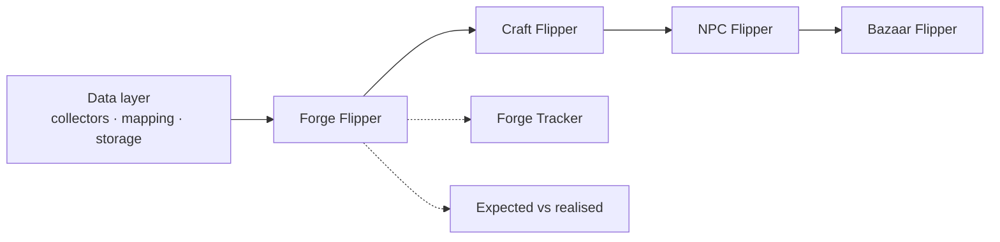
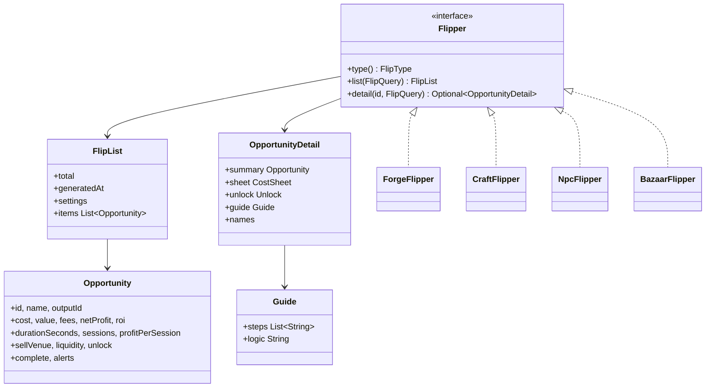
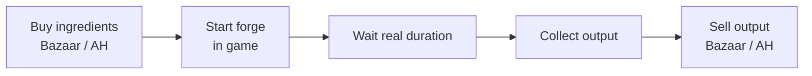
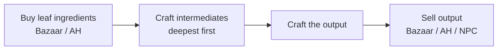
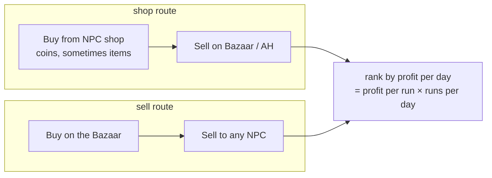
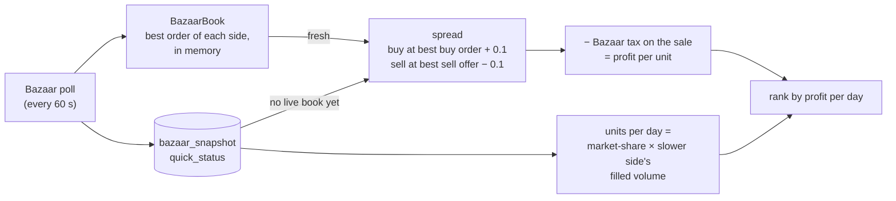

# Flippers

The MVP ships four flippers on one shared data layer and [calculation engine](calculation-engine.md), plus a [Forge Tracker](forge.md#forge-tracker) and an expected-vs-realised profit check.

**Build order inside the MVP:** data layer → Forge → Craft → NPC → Bazaar.

| Feature | What it does | Personal context used | Feasibility | Status |
| --- | --- | --- | --- | --- |
| Forge Flipper | Ranks forge recipes by profit, using real forge speed and the time until the next refill | HOTM, collections, forge speed, budget, next session | Feasible; forge timing from API to verify | **Implemented** (M2) |
| Craft Flipper | Ranks craft recipes by ingredient cost versus output value | Collections, budget | Feasible | Implemented |
| NPC Flipper | Buy from NPC, sell on Bazaar/AH (or Bazaar → NPC) | Budget | Feasible; models the 640/day NPC shop limit | Implemented |
| Bazaar Flipper | Shows spread opportunities with volume and liquidity | Budget, tax rate | Feasible; info only, competes with scripts, lowest priority | Implemented |
| Forge Tracker | Time left on each forge slot without visiting the Forge | Slots, forge speed | Manual entry with calibration; API forge data to verify | **Implemented** (M2, manual entry) |
| Expected vs realised profit | Compares prices at forge start with prices at finish | Stored snapshots | Feasible with snapshot storage | **Implemented** (M2) |

## Common shape

Each flipper is a Spring service in `flipper.<type>` that:

1. loads candidates (recipes, NPC offers or Bazaar products),
2. filters by personal context (unlocked, affordable),
3. asks the engine for cost, value, fees and metrics,
4. attaches alerts and a guide,
5. returns a ranked list to `GET /api/v1/flips/{type}` and one opportunity with its cost sheet and guide to `GET /api/v1/flips/{type}/{id}`.

`FlipQuery` carries budget, time to next session, sort, minimum volume, `includeLocked`, `includeIncomplete` and paging; unset values come from the player context. Money in an opportunity is per run (per slot for the forge). The Bazaar Flipper ranks products instead of recipes but returns the same shapes.

Shared pieces live in the `flipper` package: `RecipeBook` (NEU recipes indexed by type and output, rebuilt when NEU updates), `FlipContext` (one market view, player context, unlock cache and craft planner per request) and `FlipSupport` (filters, paging, alerts, names, guide steps).

**Missing prices are hidden by default.** An opportunity whose input or output has no price is incomplete; with thousands of craft recipes these would flood the list, so they only appear with `includeIncomplete=true` (UI: *Show missing prices*), ranked last.

## Per-flip guide and visualised recipe

Every flipper includes:

- a short **step-by-step list**, for example *buy ingredients → put in forge → collect → sell output*;
- a **mini write-up** of the logic behind it (why it is profitable, what can go wrong);
- the **recipe**, ingredient prices, totals and a cost/profit sheet for each opportunity.

The guide only describes what the player does by hand. The app never performs a step.

## Forge Flipper

**Status:** Implemented (`flipper.forge.ForgeFlipper`, UI tab *Forge Flipper*).

- All NEU forge recipes (124 on 2026-11-17) are evaluated on each request; the list answers in about 150 ms.
- Recipes gated by HOTM level or a collection tier are hidden when locked. Requirements the context cannot check are shown with an `UNLOCK_UNKNOWN` alert.
- Duration uses the player's real forge speed, not the base duration. See [Forge](forge.md).
- Ranking defaults to profit per session, so very short recipes are not inflated ([ADR 0007](decisions/0007-profit-per-session.md)).
- The guide lists each purchase (Bazaar buy order or insta-buy, AH BIN), recipe coins, where to start the recipe, when to collect and where to sell.
- Starting a job can be recorded from the detail panel to feed the Forge Tracker and the expected-vs-realised check.

First live run (2026-11-17, HOTM 7, 20% Quick Forge, 8 h sessions): Gleaming Crystal led the Bazaar-sold recipes at about 13.5M per session. Several AH-sold outputs (drills, Divan's Drill) ranked higher but with `LOW_VOLUME` alerts (and, before the venue columns, `AH_SOLD_OUTPUT`). Some results look surprising and are **to verify** in game, for example the Mithril Belt (NEU lists 3 Enchanted Mithril as its input; the AH lowest BIN was 490k).

## Craft Flipper

**Status:** Implemented (`flipper.craft.CraftFlipper`, UI tab *Craft Flipper*).

- All NEU crafting recipes with inputs are evaluated on each request (1,415 outputs with prices on 2026-11-17); the list answers in about 0.3–0.6 s.
- One opportunity per output item: when an item has several recipes (Enchanted Diamond from diamonds or from diamond blocks), the most profitable complete one is shown.
- Recipes gated by a collection tier (`Requires: Diamond IV`) or HOTM level are hidden when locked, like forge recipes.
- **Intermediates:** each input is bought or crafted from its own ingredients, whichever is cheaper, down to 3 levels (see [Calculation engine](calculation-engine.md#intermediates-buy-or-craft)). The Forge Flipper and Forge Tracker use the same planner, so forge inputs such as Enchanted Mithril are crafted when that is cheaper.
- Crafting is instant: duration is 0, there is no profit per hour, and ranking is by profit per craft or ROI. The real limit is how much the market absorbs, so the guide states the daily volume.
- **Several recipes.** An item with more than one recipe is listed once, with the recipe that earns the most per item made: recipes can make different counts a craft (2 or 40), so a big batch does not win on size alone. Money in the row is per craft; the detail names the count ("one craft makes 40") and compares the recipes per item.
- **Bulk crafts hidden.** With *Bulk crafts too* off, a flip whose cheapest plan needs bulk crafting is planned again with fewer crafting levels, and the best plan that fits an inventory is shown instead; so a flip seen at *2 steps* does not vanish at *Any*.
- **Craft steps.** The list can be limited to 1 step (buy every input, craft once) or 2 steps (an input may be crafted first); *Any* allows up to 4. Fewer steps means less work and fewer bulk crafts, usually for less profit.
- **Bulk crafts.** Crafting parts from cheaper ones can multiply the work: an item made from enchanted blocks bought as base items needs 160 × 160 base items per block. When the purchases of one run do not fit in one inventory (2,304 items) the row gets `BULK_CRAFT` and is hidden unless *Bulk crafts too* is on. On 2026-11-19 this was 158 of 386 craft flips (Blood God Sigil: about 1.6 million items and 10,000 crafts, shown before as "2 crafts"). The crafting tree shows *Crafts in all* and *Items to buy* next to the number of recipes.
- The guide lists purchases summed per item, each intermediate craft with what it saves over buying, the final craft and where to sell. The detail panel shows the ingredient tree.

First live run (2026-11-17): the Bazaar-sold leaders were Hotspot Water Orb (~47M per craft) and Ultimate Bobbin' Time (~30M). Most high-profit rows sold on the AH, often with `LOW_VOLUME`. Thin AH markets were a weak point: one joke listing or one upgraded copy set the value (a 100M Rabbit Helmet that never sold, a 44M 5-star Yeti Sword).

**After the first test (2026-11-18):** AH values come from clean copies only, `FEW_SALES` flags values from fewer than 3 clean sales (hidden by default), and Coflnet backfill supplies a week of sales. With those, the joke rows drop out of the default list; Annihilation Cloak (clean sales about 196M) leads with `UNLOCK_UNKNOWN` for Blaze Slayer 7, and Ultimate Carrot Candy keeps its row but with two `WIDE_SPREAD` alerts: buying Superb Carrot Candy instantly instead of by order would cost more than the whole profit.

## NPC Flipper

**Status:** Implemented (`flipper.npc.NpcFlipper`, UI tab *NPC Flipper*).

- **Shop route** (`shop:<NPC>:<item>`): every NEU `npc_shop` recipe (1,095 on 2026-11-17). Coin costs are the recipe coins; item costs are bought or crafted like recipe inputs. Shops paid in special currencies (Bits, Copper, Motes, Pelts, North Stars…) have no market price, so they are incomplete and hidden by default.
- **Sell route** (`sell:<item>`): every Bazaar product with an NPC sell price (Hypixel items resource). Bought on the Bazaar only, sold to an NPC without fees.
- **Runs per day:**
  - shop: `min(npc.daily-limit, npc.market-share × output daily volume) ÷ items per purchase`; the market share part is skipped when the output sells to an NPC;
  - sell: `npc.market-share × daily volume` of the item (NPCs buy any amount).
- Ranking defaults to profit per day; profit per run and ROI are available. There is no duration.
- The guide names the NPC and its island (from NEU, for example *Zog (Hub)*) and how often to repeat.
- All 1,328 priced routes answer in about 0.2–0.3 s.

**To verify:** that the 640 limit is per item across all NPCs, that selling to NPCs is unlimited, and whether 5% of daily volume is a sensible default share.

First live run (2026-11-17): Jungle Key from Odawa (~76M a day at the 640 limit) and Bazaar → NPC routes for Flawless gemstones and enchanted crops led. Several top rows were momentary Bazaar dumps (Enchanted Potato's top buy order fell from 235 to 2–3); they carry a `RECENT_CHANGE` alert. Pet outputs (Golden Dragon) are overvalued because AH sales mix pet levels.

## Bazaar Flipper

**Status:** Implemented (`flipper.bazaar.BazaarFlipper`, UI tab *Bazaar Flipper*). **Information only:** it competes with automated scripts, warns that spreads close quickly, and HyFlip never places or relists orders.

- **Candidates:** every Bazaar product with orders on both sides (about 1,740 on 2026-11-18). The ID is the item ID.
- **Prices:** always order to order, whatever `trading.price-source` says. A buy order goes one step (0.1) above the best buy order, a sell offer one step under the best sell offer; the Bazaar tax is taken on the sale.
- **Live book:** `quick_status` prices are averages over the top of the book and can sit far from the best single order (Enchanted Wheat on 2026-11-18: `buyPrice` 973 while the best sell offer was 406.7). The Bazaar collector therefore keeps the best price level of each side from every poll in memory (`market.BazaarBook`); it is not stored. Until the first poll after a start, the flipper falls back to `quick_status` and says so in the guide.
- **Units per day:** buy orders fill when others insta-sell (`sell_moving_week`), sell offers when others insta-buy (`buy_moving_week`). The slower side limits the flip; `bazaar.market-share` of it is the daily estimate.
- **Alerts:** the shared alerts (`RECENT_CHANGE`, `STALE_PRICE`, `LOW_VOLUME`) compare `quick_status` with its own history, so a live book price is not mistaken for a sudden move. `THIN_BOOK` is added when a side has fewer than `bazaar.thin-book` orders, or when the best order stands more than 25% away from the next price level (a lone order that sets the spread).
- **Guide:** buy order size and total, the sell offer price, and a reminder to check the book first.
- The full list answers in about 0.25 s.

**To verify:** whether 5% of the slower side is a sensible share when scripts compete for the same spread, and whether fills really follow the moving-week volumes.

First live run (2026-11-18): high-value products with steady volume led (Wither Catalyst ~16% per unit, ~115M a day at 5%; Fuming Potato Book; Jungle Key). Many high-ROI rows (Enchanted Honeycomb 250–530%, Glacial Fragment, Kuudra Teeth) carry `RECENT_CHANGE` or `THIN_BOOK`: the book moved during the last minutes or a single order sets the spread. Before the live book was used, `quick_status` averages inflated spreads (Enchanted Wheat showed 186% ROI instead of about 15%).

## Volume and how it sells

Every flipper has volume columns and filters, since a flip that earns 50M once a week is not the same as one that earns 5M every few minutes.

- **Columns.** *Volume/day* (units of the output that sell a day, on the side the sale waits on), *Market runs/day* (the slower of selling the output and buying the scarcest input, in runs; red below one a day), *Input runs/day*, *Output runs/day* and *Sellers* (sell offers or BIN listings ahead of you). The first two show by default; the column choice was reset once when they came in.
- **Volume filter** (button next to *Columns*): minimum volume a day (asked of the server, so it searches past the first 500 rows), minimum market runs a day, longest fill time and most sellers.
- **Sell filter** (forge, craft, NPC): *BZ order* lists flips that sell on the Bazaar, priced with buy orders and sell offers; *Insta* the same priced with insta-buy and insta-sell; *AH* those that sell on the Auction House; *NPC* those sold to an NPC. *BZ order* and *Insta* price the list and its detail that way for this tab only; Settings stay as they are.
- Flip Calc buys a craft's or forge recipe's inputs no faster than its share of the scarcest input's volume.

## Flip Calc

Splits a budget across the four flippers for the time until the coins are needed (`src/app/src/calc/advisor.ts`). It reads the top 150 rows of each list and calculates only when *CALCULATE* is pressed; the result stays while the app runs, also when other tabs are visited, and the button pulses when the inputs have changed since.

- **Craft steps** (1, 2, Any): the depth of the craft flips it reads, as in the Craft Flipper.
- **Most flips** (a number; empty for no limit): the most different flips in the plan. A plan with more is solved again twice, once on the flips worth most in total and once on those worth most per coin, and the better is kept. The flips that fall out are listed under *Left out* with the reason.
- Bulk crafts (`BULK_CRAFT`) are always left out; craft and forge flips are read with the plan that fits an inventory. A craft's units are crafts: "craft 9 times (360 items, 40 a craft)".

## Expected vs realised profit

**Status:** Implemented (Forge Tracker tab, `GET /api/v1/forge/jobs`).

When a forge job is recorded, the expected cost and net output value are stored in `forge_job`. Once its end has passed, the realised value is computed from the last prices at or before the end. The difference shows how much prices moved during the job and feeds trust in future rankings.
