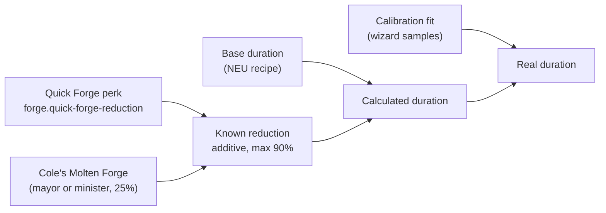
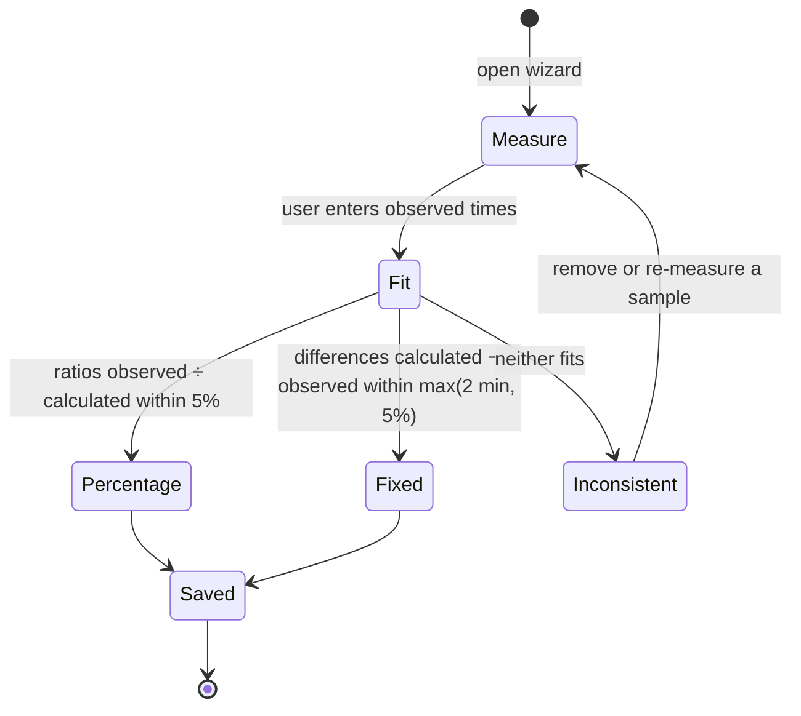
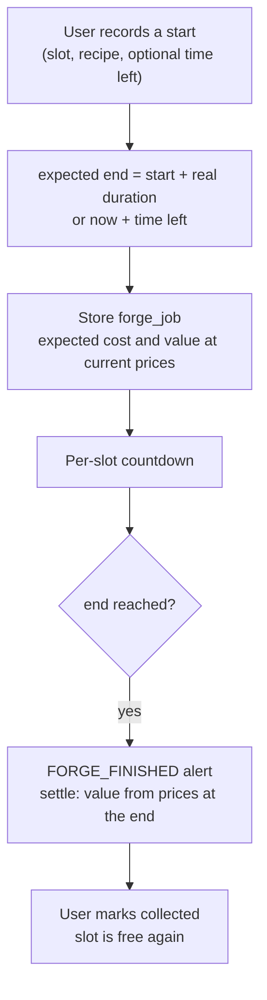

# Forge

There is no universal forge duration. Generic lists show base durations, while real times can be much shorter (one recipe listed at 17.5 h finished in 4.5 h). HyFlip combines known modifiers with a short calibration, and will prefer real data from the profile API once profile linking exists.

**Status:** Speed model, calibration, Forge Flipper and Forge Tracker implemented in M2. Perk values and the profile API questions below are **to verify**.

## Speed model

1. **Known modifiers.** The Quick Forge reduction is entered as the percentage the HOTM tree shows (`forge.quick-forge-reduction: 0.2` for 20%), so the app does not depend on the perk's level formula. Molten Forge is detected from the stored election resource (mayor perks and the minister perk) unless `forge.molten-forge` forces it `ON` or `OFF`.
   `calculated = base × (1 − quickForge − moltenForge)`
2. **Calibration.** Any remaining gap between calculated and observed times is fitted from samples (below).
3. **Profile API (later).** If forge timing can be read from the profile API, real end times will replace the model for running jobs.

Implemented in `engine.ForgeSpeed` and `engine.Calibration`; the service is `flipper.forge.ForgeCalibrationService`.

## Calibration wizard

The wizard suggests three unlocked recipes with base durations near 1 h, 6 h and 24 h. The user starts each (or uses ones already running) and enters how long each really took. Each sample stores the base duration, the known reduction in effect at the time, and the observed duration, so samples stay valid after perks change.

| Fit | Real duration | Notes |
| --- | --- | --- |
| `NONE` | calculated | No samples |
| `PERCENTAGE` | calculated × mean ratio | With one base duration only, a provisional percentage is used |
| `FIXED` | max(0, calculated − mean difference) | |
| `INCONSISTENT` | calculated | The UI asks to re-check a sample |

A fit is *provisional* while it rests on fewer than 3 samples or fewer than 2 different base durations.

## Forge Flipper

See [Flippers](flippers.md#forge-flipper) and `GET /api/v1/flips/forge` in the [API](api.md). Recipes with a HOTM or collection requirement the player does not meet are hidden unless `includeLocked` is set. Requirements come from NEU `crafttext`, including combined ones such as "Gemstone X & HotM 5"; collection names are matched to IDs through the collections resource.

## Forge Tracker

Shows time left on each forge slot without visiting the Forge, and flags finished slots.

- Jobs are recorded by hand (`source = MANUAL`) or read from the linked profile (`source = PROFILE_API`). Entering the time left as shown in game makes the end time exact even before calibration.
- **Profile sync.** Each profile read brings the tracker in line with the forge; the profile wins:
  1. A tracked job in the same slot with the same item and start (±5 min) is kept.
  2. Else a tracked job with the same item that had not ended before the profile's job started is the same job recorded by hand: it moves to the profile's slot and start time.
  3. A tracked job left in a slot the profile shows busy was collected and refilled in game. A job missing from the profile is marked collected once it has finished (the profile can lag).
  4. Jobs the tracker does not know are recorded, with prices of the moment.
- A slot holds at most one uncollected job (enforced by a unique index).
- The slot count comes from `player.forge-slots`. If unset, it is the highest slot seen in use: busy in the linked profile now, or in any job in the forge history (2 at least, 7 at most). The profile API does not report unlocked slots, and slots never get locked again, so collecting the jobs in the last slots does not shrink the forge. The UI says when the count is not set by hand.
- **Expected vs realised.** At start the job stores the input cost and the net output value at current prices. Once the expected end has passed, the realised value is computed from the last prices at or before the end (settled when the tracker is read). The difference shows how far prices moved during the job.
- **End times** are shown as a clock time in the zone from `display.time-zone` (Settings → Time), with the day when it is not today: "18:40", "01:10 tomorrow".
- **Plan for free slots.** Above the slots the tracker suggests what to start in the empty or finished slots: the mix of recipes with the highest total profit per session within the budget (see [API](api.md#forge-planner)). A slow-selling output fills at most one slot (two at medium liquidity). *Started* records the job.
- Desktop notifications for finished slots move to Publish (Tauri notification plugin).

### Open questions (to verify)

- [x] The profile API exposes busy forge slots with item and start time (`forge.forge_processes`), but not the number of unlocked slots.
- [ ] How delayed is profile API data compared with the game?
- [x] The Quick Forge level is exposed directly (`skill_tree.nodes.mining.quick_forge`); the percentage per level is derived (**to verify** the formula in game).
- [ ] Molten Forge is still 25% and stacks additively with Quick Forge.

## Next session

The player sets when they can next refill a slot: `forge.next-session-in` (default 8 h) or the *Next session in* field in the UI. The Forge Flipper uses it to rank by profit per session. See [Calculation engine](calculation-engine.md#why-profit-per-session).
