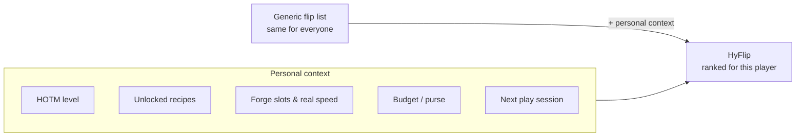
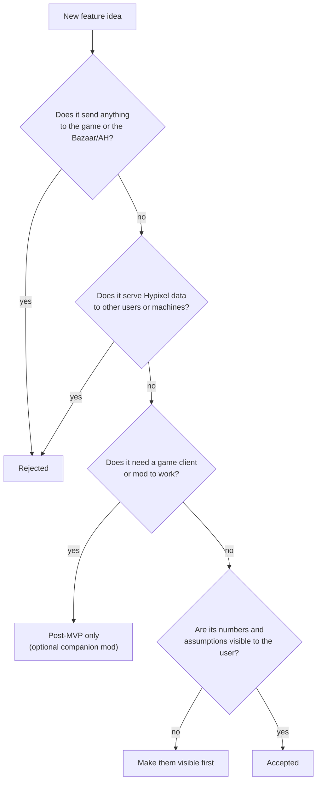

# Overview

| Item | Decision |
| --- | --- |
| Short name | HyFlip |
| Long name | HyFlip Hypixel SkyBlock Flipping Toolkit |
| License | GPL-3.0-or-later |
| Language (UI and docs) | English |
| Platforms | Linux and Windows first; mobile later |
| Audience | Open-source; each user runs their own local instance |
| Target edition | Minecraft: Java Edition (Bedrock cannot join Hypixel SkyBlock) |

## Why it exists

Real sessions showed where generic flip lists mislead:

- Forge durations are shown as fixed values, while in-game times are much shorter (one recipe listed at 17.5 h finished in 4.5 h).
- Lists rank by profit per hour, which inflates 30-second recipes that cannot realistically be repeated.
- A sudden ingredient price spike made a craft flip look profitable when it was a loss.
- Lists do not know when the player can next refill a forge slot (sleep, work, offline time).
- The best results sit behind a paid tier.

HyFlip's core difference is **personal context**: the player's HOTM level, unlocked recipes, forge slots, real forge speed, purse and next play session.

## Design principles

The app reads and shows; it never acts in the game. Every feature is checked against these rules.

1. **Read-only, no automation.** HyFlip never sends clicks, commands, chat messages or Bazaar/AH orders. It calculates, visualises and recommends; the player does every in-game action by hand. Hypixel bans tools that automate placing orders, claiming items, relisting or clicking menus.
2. **No game client required.** The MVP is a standalone app, not a Minecraft mod, so it carries no ban risk. An optional companion mod is a post-MVP idea only.
3. **Local-first.** All data, settings and history live on the user's machine. Each user runs their own instance with their own API key.
4. **Open-source and transparent.** Calculations, data sources and assumptions are visible and configurable.
5. **Highly customisable.** Filters, thresholds, retention and price sources are user settings, not hard-coded.

### Feature checklist

Before a feature is accepted it must pass every question:

## Non-goals

- **LLM-based price prediction.** Dropped as unreliable and inefficient. Statistical signals are used instead.
- **Proxying Hypixel API data** to other developers or users. Hypixel's API policy forbids building an application that proxies the Public API to third-party developers.
- **Any form of auto-buying, auto-selling or order management.**
