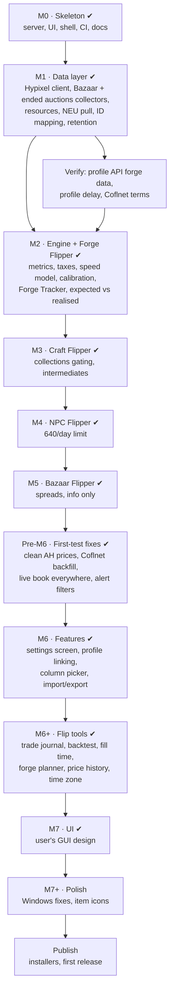

# Roadmap

## MVP milestones

| Milestone | Scope | Status |
| --- | --- | --- |
| M0 Skeleton | Maven server with health endpoint, token filter, SQLite + Flyway schema; React UI connecting to it; Tauri shell starting the server; CI; docs | **Done** |
| M1 Data layer | Collectors for Bazaar, ended auctions, tracked auctions, resources; NEU pull; ID mapping; retention job; status endpoint and UI panel | **Done** (Coflnet backfill moved to M6) |
| M2 Forge | Engine metrics, Forge Flipper, speed model, calibration wizard, Forge Tracker, expected vs realised | **Done** (manual job entry; profile API forge data still to verify) |
| M3 Craft | Craft Flipper, buy-vs-craft intermediates | **Done** (crafting intermediates only, depth 3) |
| M4 NPC | NPC Flipper | **Done** (shop → market and Bazaar → NPC; `RECENT_CHANGE` alert pulled forward from M6) |
| M5 Bazaar | Bazaar Flipper | **Done** (spreads from the live order book top, kept in memory; `THIN_BOOK` alert) |
| Pre-M6 | Fixes from the first hands-on test (2026-11-18): AH values from clean copies only (`ItemCondition`), lowest BIN from the latest scan only, `FEW_SALES` and `WIDE_SPREAD` alerts, Coflnet sale backfill, live order book in every flipper with orders one step ahead, `hideAlerts` / `search` / `hotm` list filters, Buys / Sells venue columns (replacing `AH_SOLD_OUTPUT`), concrete order prices in guides, recorded sale value and history delete in the Forge Tracker | **Done** |
| M6 Features | Settings screen (profile, fees and tax tiers, thresholds, theme and accent colour) saved in the app, API key entry, profile linking (Mojang + profiles: HOTM, Quick Forge, collection tiers, forge jobs into the Forge Tracker), column picker, `MANIPULATION` alert, history import/export | **Done** (desktop notifications and the published database move to Publish) |
| M6+ Flip tools | Trade journal (expected vs actual per flipper and alert), backtest over stored history, Bazaar order fill-time estimate, forge slot planner within budget, item price history API and chart, time zone for forge end times; faster flip lists (bulk price loading) and incremental 7-day averages, which also fixes averages that never refreshed | **Done** |
| M7 UI | Rebuild the UI on the user's GUI design | **Done** (tested on Linux and Windows 11, 2026-11-19) |
| M7+ Polish | Windows fixes (jar path, console window, server log, Java from the registry, faster shutdown), item icons from the Hypixel SkyBlock pack and the player's Minecraft textures | In progress |
| Publish | Installers, bundled runtime decision, published history database, desktop notifications, first release | Planned |

## Post-MVP

- **Fusion Flipper:** buy shards, fuse them, sell the result (Galatea shard system).
- **Kat Flips:** pet rarity upgrades through Kat, compared against AH prices of the upgraded pet.
- **Optional companion mod:** a Fabric mod for data the API does not expose (for example live Bazaar order states). Read-only, same rules as the app.
- **Mobile access:** the web-based UI can later be opened from a phone or packaged for mobile.
- **Live push channel:** SSE from server to UI for alerts and new snapshots.
- **Code signing for Windows:** sign the installers (SignPath Foundation, free for open source) so SmartScreen stops warning. Decided together with the application key below.
- **Always-on collection server and application key:** a project-owned server with a Hypixel application key, removing personal-key renewal and offline gaps. Must be designed so it does not proxy the Public API to third parties.
- **Bundled Java runtime:** ship a `jlink` runtime so users without Java 17+ can run the app. It must include `java.desktop` (ImageIO builds the item icons).

## Open questions and tests

**To be tested**

- [x] The SkyBlock profile API exposes busy forge slots with item and start time; the Forge Tracker is filled from it. The number of unlocked slots is not exposed.
- [ ] Quick Forge per level (10% + 0.5% per level, 30% at 20) and the HOTM experience table against the game.
- [ ] How delayed is profile API data compared with the game?
- [x] Coflnet API terms and rate limits: free public endpoints, 100 requests a minute, attribution required, Premium+ for commercial products (see [Data sources](data-sources.md#coflnet)).
- [x] Bazaar `buyPrice`/`sellPrice` semantics against live data (see [Data sources](data-sources.md#get-v2skyblockbazaar)).
- [ ] Bazaar tax rate and AH listing fee tiers / claim tax in game (config defaults: 1.25%; 1% / 2% / 2.5%; 1% above 1M).
- [ ] Quick Forge and Molten Forge values, and that they add up.
- [ ] Surprising Forge Flipper results against the game, for example Mithril Belt (NEU: 3 Enchanted Mithril).
- [x] Craft Flipper outliers from thin AH markets: values now come from clean copies only, and fewer than 3 clean sales in 7 days raise `FEW_SALES` (hidden by default).
- [ ] Forge durations against NEU: the player saw 4 h in game for Travel Scroll to the Dwarven Base Camp, NEU says 10 h base. Check the base time shown in game.
- [ ] NPC limits: is 640 per item across all NPCs, is selling to NPCs unlimited, is a 5% market share a sensible default?
- [ ] Bazaar Flipper: is 5% of the slower side's volume realistic against scripts, and do fills follow the moving-week volumes?
- [ ] Do Bazaar orders fill as fast as the moving-week volume suggests (`fillSeconds`)? Compare with real orders.
- [ ] Backtest over several days: which alerts predict a shortfall? (First 2 h: Bazaar flips with `RECENT_CHANGE` realised about 40% of the prediction, the rest about 90%.)
- [ ] AH prices of pets mix levels (a level-1 Golden Dragon is valued like levelled ones). Needs level-aware pricing or exclusion.
- [ ] Real Bazaar snapshot storage size over a full day (first measurement in [Database](database.md#storage-estimate)).

**Deferred decisions**

- [x] Core metric definitions: see [ADR 0007](decisions/0007-profit-per-session.md). Default price source stays `ORDER`.
- [x] Programming languages and stack: Java 17 + Spring Boot (Maven), Tauri + React/TS, SQLite with JDBC + Flyway. See [Decisions](decisions/README.md).

## Risks

| Risk | Impact | Mitigation |
| --- | --- | --- |
| Item ID mismatches across sources | Wrong prices on some items | Mapping layer with 97% Bazaar coverage, unmapped review list, tests per item category |
| Cold start (empty history) | Weak alerts in the first days | Published databases, import, optional backfill |
| Coflnet dependency | Backfill breaks if their API changes | Keep backfill optional; Hypixel stays primary |
| Hypixel API or game changes | Recipes, prices or endpoints shift | Daily NEU pull, versioned data, update notes |
| NEU repository license | Reuse conditions on recipe data | **Resolved:** MIT licensed; keep its copyright notice with published data |
| Personal key expires every 3 days | Profile features stop until renewed | Expiry warning; Bazaar/AH work without a key; application key later |
| No suitable Java on the user's machine | Server cannot start | Clear error with instructions; bundled runtime later |
| Snapshot storage size | Database grows past 1 GB per week | Unchanged rows are skipped (implemented); configurable retention; track subsets if still too large |
| Data missed while the app is closed | Gaps in history, missed sales | Gaps recorded and shown; Coflnet backfill; always-on server later |
| Bandwidth | Full auction scans are ~55 MB; ~1 GB/day for Bazaar + ended auctions | 30 min scan default, skipped when nothing is tracked; intervals configurable |
